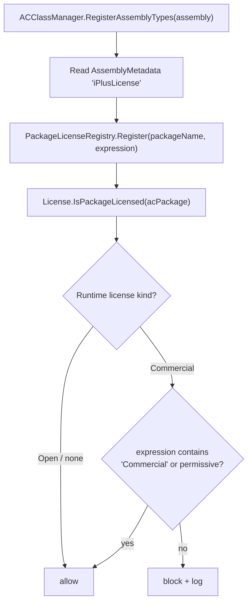

# Handover: Dual-Licensing Distribution & Publishing (iPlus V5)

> **Purpose:** Give this file to a new chat session to implement the distribution/publishing
> strategy for iPlus V5 under the dual-licensing model. It captures the decisions and context
> from the session on 2026-10-23.

## Implementation status (2026-10-25)

| # | Task | Status | Where |
|---|---|---|---|
| 1 | `gip.core.licensing` library (signed license files) | ✅ done | [gip.core.licensing/](../gip.core.licensing/readme.md) |
| 2 | Licensing unit tests (31 tests) | ✅ done | [gip.core.licensing.unit.test/](../gip.core.licensing.unit.test/) |
| 3 | `gip.tool.licenseIssuer` CLI | ✅ done | [gip.tool.licenseIssuer/](../gip.tool.licenseIssuer/readme.md) |
| 4 | File licensing wired into `gip.core.datamodel.License` | ✅ done | [License.FileLicensing.cs](../gip.core.datamodel/ACHelperclasses/ACLicense/License.FileLicensing.cs) |
| 5 | `gip.tool.dbscript` initial-install generator | ✅ done | [gip.tool.dbscript/](../gip.tool.dbscript/readme.md) |
| 6 | Publish-release script + GitHub Actions workflow | ✅ done | [build/publish-release.sh](../build/publish-release.sh), [.github/workflows/release.yml](../.github/workflows/release.yml) |
| 7 | docker-compose evaluation bundle | ✅ done | [deploy/docker/](../deploy/docker/README.md) |
| 8 | Packaging excludes + docs | ✅ done | [build/iPlus.Package.props](../build/iPlus.Package.props), [docs/release-process.md](./release-process.md) |
| 9 | Build and verify new projects | ✅ done | `dotnet build` + `dotnet test` + `publish-release.sh` for `desktop-linux`, `service` and `browser` |
| 10 | Package license metadata mechanism (decided) | ✅ done | see [§7](#7-license-metadata--gplcommercial-mixing-decided-2026-10-25) |
| 11 | `IPlusLicenseExpression` → `AssemblyMetadata` MSBuild target | ✅ done | [Directory.Build.targets](../Directory.Build.targets) |
| 12 | Dual-license gip's own packages (`GPL-3.0-or-later OR LicenseRef-Commercial`) | ✅ done | 43 gip + 24 iPlusMES csproj files + [Directory.Build.targets](../Directory.Build.targets) |
| 13 | `PackageLicenseRegistry` (package → expression, classification) | ✅ done | [PackageLicenseRegistry.cs](../gip.core.datamodel/ACHelperclasses/ACLicense/PackageLicenseRegistry.cs) |
| 14 | Re-enable `License.IsPackageLicensed` / `IsComponentLicensed` + mixing rule | ✅ done | [License.cs](../gip.core.datamodel/ACHelperclasses/ACLicense/License.cs) |
| 15 | Multi-issuer PKI chain (`IssuerPublicKey` in `DeveloperIssuer`, `IssuerKeyId` in `Product`) | ✅ done | `gip.core.licensing` + [LicenseVerifier.cs](../gip.core.licensing/LicenseVerifier.cs) |
| 16 | `LicenseKind.FrameworkRuntime` + `MaxUsers` → `MaxLicensedWinSessions` | ✅ done | `gip.core.licensing` + [Environment.cs](../gip.core.autocomponent/ACIPlus/Environment/Environment.cs) |
| 17 | Rewire `BSOLicenseActivation` / `BSOiPlusLicenseManager` off the V4 path | ✅ done | [BSOLicenseActivation.cs](../gip.bso.iplus/BSOiPlus/BSOLicenseActivation.cs), [BSOiPlusLicenseManager.cs](../gip.bso.iplus/BSOiPlus/BSOiPlusLicenseManager.cs) |
| 18 | Fix `ActivateLicenseFile` dedupe key (`LicenseId`, not `CustomerName`) | ✅ done | [License.FileLicensing.cs](../gip.core.datamodel/ACHelperclasses/ACLicense/License.FileLicensing.cs) |
| 19 | Two-stage grace period (30 min warning, 1.5 days `ACUrlCommand` block) | ✅ done | [LicenseGracePeriod.cs](../gip.core.licensing/LicenseGracePeriod.cs), [License.FileLicensing.cs](../gip.core.datamodel/ACHelperclasses/ACLicense/License.FileLicensing.cs), [ACBSO.cs](../gip.core.autocomponent/ACComponent/ACBSO.cs) |
| 20 | `issue-runtime` CLI command + `--developer-public-key` for issuer licenses | ✅ done | [gip.tool.licenseIssuer/Program.cs](../gip.tool.licenseIssuer/Program.cs) |
| 21 | Licensing tests extended (91 tests) | ✅ done | [gip.core.licensing.unit.test/](../gip.core.licensing.unit.test/) |
| 22 | Grace-period clock persisted across restarts (`<LicenseFolder>/.licensegrace`) | ✅ done | [License.FileLicensing.cs](../gip.core.datamodel/ACHelperclasses/ACLicense/License.FileLicensing.cs) |
| 23 | Removed the dead `IsTrial && !IsTrialTimeExpired` branch in `ACClassDesign.CheckMenuRights` | ✅ done | [ACClassDesign.cs](../gip.core.datamodel/EntityACClass/ACClassDesign.cs) |
| 24 | Removed the V4 TDi Matrix USB dongle path (`Mxapi.cs`, `Mxtea.cs`, `matrix.ini`, `MATRIX32/64.DLL` copies, `#region Dongle-Operations`, dongle decryption helpers) — fixes `DllNotFoundException` on Linux | ✅ done | [License.cs](../gip.core.datamodel/ACHelperclasses/ACLicense/License.cs) |
| 25 | Deleted the V4 dongle tooling projects `gip.tool.devLicense` / `gip.tool.devLicenseProvider` | ✅ done | `iplusAll.slnx`, [build/iPlus.Package.props](../build/iPlus.Package.props) |
| 26 | Fixed EF Core translation failure on `byte[].Length` in the file-license loader (client-side evaluation) | ✅ done | [License.FileLicensing.cs](../gip.core.datamodel/ACHelperclasses/ACLicense/License.FileLicensing.cs) |
| 27 | Fixed infinite recursion in `License.SystemID` (guard read `SystemID.HasValue` instead of `_SystemID.HasValue`) — crashed iPlusMES with a stack overflow | ✅ done | [License.cs](../gip.core.datamodel/ACHelperclasses/ACLicense/License.cs) |
| 28 | Verified both console hosts start end-to-end after the licensing changes (`gip.iplus.console` and `gip.mes.console` → login, iPlus init, service ready) | ✅ done | `bin/Debug/net10.0/` |

**Not yet done (needs decisions or external resources):**

- **Velopack auto-update** — replaces `gip.tool.installerAndUpdater`. Requires a
  code-signing certificate for Windows; not started.
- **Android/iOS artifacts in CI** — the workflow has an `android` job, but it needs
  the Android SDK and a signing keystore. iOS needs a macOS runner and Apple
  certificates; not configured.
- **Commercial module packaging** — separate packages vs. plugin drop folder is
  still an open question (see below).
- **Online activation service** — explicitly deferred; offline signed files are the
  baseline.
- **License enforcement** — implemented (items 10–22). Remaining follow-ups:
  - `BSOiPlusLicenseManager` has **no XAML file** in the repo — its UI is generated from
    the `ACPropertyInfo`/`ACMethodInfo` attributes. The V5 path
    (`DeveloperPrivateKeyPath` + `IssueProductLicenseFile`) is therefore wired in and
    should render automatically, but it has not been verified in a running app yet.
  - The `gip.tool.devLicense` / `gip.tool.devLicenseProvider` V4 dongle tools have been
    **removed** from the tree (see §6).

## Background

- iPlus V4 was closed source; binaries were distributed by downloading and running
  `gip.tool.installerAndUpdater` (Windows-only, WPF, `net6.0-windows`, untested since V4).
  Binaries were stored on the gipsoft webserver.
- V5 switches to a **dual-licensing model** (open core + commercial modules).
- V5 already has a local NuGet feed (`local-packages/`, filled by `build/pack-local.sh`)
  consumed by dependent solutions (iPlusMES, iPlus-Examples) via their `nuget.config`.
- Launch projects (`gip.iplus.client.avui.*`, `gip.mes.client.*`) are **not packable**
  (excluded in `build/iPlus.Package.props` and `build/pack-local.sh` as of 2026-10-23).
  They are thin `OutputType=Exe` shells; consumers create their own launch projects that
  reference the `iPlus.*` component packages.

## Goal

Publish the complete program (all platforms) **including the necessary database files
(SQL Server)** for both license editions, replacing the V4 webserver + updater model.

## Decisions / Recommendations to implement

### 1. Separate source distribution from binary distribution

| Channel | Content | Audience |
|---|---|---|
| GitHub / NuGet.org | Source + `iPlus.*` library packages (via `build/pack-local.sh` logic) | Developers, open-source license |
| GitHub Releases (or webserver) | Ready-to-run binaries per platform | End users, both licenses |

NuGet packages are for developers composing launch projects; end users need published,
self-contained outputs. One artifact must not serve both.

### 2. Per-platform binary publishing (GitHub Releases)

Produce self-contained artifacts and attach them to GitHub Releases
(free CDN, checksums, semantic versioning — replaces the webserver hosting):

- **Desktop (Windows):** `dotnet publish gip.iplus.client.avui.Desktop -c Release -r win-x64 --self-contained -p:PublishSingleFile=true` → zip
- **Desktop (Linux):** same with `-r linux-x64`
- **Browser:** `dotnet publish gip.iplus.client.avui.Browser` → zip deployable to any static file server / ASP.NET Core host (users get a URL, nothing to install)
- **Android:** `.apk` attached to the GitHub Release (Play Store optional for commercial customers)
- **Auto-update:** replace the hand-rolled V4 updater with **Velopack** (https://velopack.io/) —
  modern cross-platform successor to Squirrel, delta updates, code signing, Avalonia-compatible.
  Keep `gip.tool.installerAndUpdater` only if its SQL Server install/backup wizardry is still
  needed for on-premise customers; otherwise freeze/retire it.

### 3. Database (SQL Server)

**Do NOT ship `.mdf` files.** Ship schema + migrations:

- Use the existing **`gip.core.dbsyncer`** to apply schema updates on startup
  (works for fresh installs and upgrades, both editions).
- For fresh installs, execute the existing SQL scripts from
  `gip.tool.installerAndUpdater/DatabaseConfiguration/*.sql` (or a DACPAC) via the setup wizard.
- Ship a **`docker-compose.yml`** bundle: `mssql/server` + iPlus service + browser client —
  one command to a running system, no local SQL Server install. Biggest UX win for the
  open-source/evaluation edition.

### 4. Dual-licensing structure

- **Open edition:** core framework + datamodel + standard BSOs (everything already packed to
  NuGet) under the open license; binaries on GitHub Releases.
- **Commercial edition:** same binaries + proprietary modules (licensed BSOs).
  Ship commercial modules as **separate NuGet packages or a plugin drop folder** — the
  framework's plugin/BSO loading allows adding commercial bits without rebuilding the open core.
- License key checks must live **only in the commercial assemblies**; the open build must
  contain no key/phone-home code.

### 5. Initial database script generation (schema + data)

Current model (must keep working): the EF model is generated/updated via **reverse
engineering** using scripts. New scripts are placed in the `DbScripts` directories and are
copied into the assemblies' output directory:

- `/iPlus/gip.core.datamodel/DbScripts/iPlus`
- `/iPlusMES/gip.mes.datamodel/DbScripts/iPlusMES`

When logging in **holding the Ctrl key**, these scripts are executed against the database to
keep it synchronized with the EF model. Additionally, **design updates** shipped as zipped
files in the `VBControlScripts` folders are imported into the database during this process.
The database connection string is visible in the model-update scripts (e.g.
`iPlusMES/gip.mes.datamodel/CodeTemplates/iPlusModelUpdate.sh`).

**To implement:** the distribution/publishing program should be able to automatically
generate an **initial SQL script containing both schema and data** directly from a
(Reference-)database, and include this script in the distribution package for **initial
installations**:

- Add a "generate initial install script" step to the publish pipeline (e.g. a mode of
  `gip.tool.publish` or a new tool) that connects to a reference database (connection string
  as parameter, same format as in `iPlusModelUpdate.sh`) and emits a single idempotent
  `initial-install.sql` (schema + seed data; consider `sqlpackage`/DACPAC export or
  ScriptDOM-based generation).
- The installer/first-run flow then applies: `initial-install.sql` (fresh installs only) →
  `DbScripts` incremental updates (dbsyncer / Ctrl-login sync) → `VBControlScripts` design
  imports. Existing installations skip the initial script and only run the incremental parts.
- The generated script must be versioned with the suite version and attached to the same
  GitHub Release as the binaries.

### 6. Software-based licensing (USB dongles removed)

V4 model (now removed): a `License` class with two hardware dongle types —
a **development dongle** for developers building/commercially distributing software on iPlus
(they generate software keys for their packages, installed on the client's target
system/database) and a **development dongle for end users** (access to engineering/development
features only). See the iPlus license system docs: gip issues development licenses to
developers; developers issue per-database **product licenses** for their **product packages**
to end users; license files (`CustomerName-license.gip`) are optionally signed with the gip
private key; remote login without dongle exists via code exchange in the License Manager.
V4 tooling (`gip.tool.devLicense`, `gip.tool.devLicenseProvider`, `Mxapi.cs`, `Mxtea.cs`,
`matrix.ini`, `MATRIX32.DLL`/`MATRIX64.DLL`) has been **deleted** in V5.

**Goal:** purely software-based licensing, no hardware dongles. Options to evaluate:

1. **Offline signed license files (closest to current model, recommended baseline):**
   Keep the existing flow (License Manager generates `*.gip` license file bound to a
   database) but replace the dongle check with **asymmetric cryptography**: license files are
   signed with the issuer's **private key**; the framework validates with an embedded
   **public key**. Bind licenses to a machine fingerprint (hash of machine name + DB name +
   CPU/disk IDs) or to the database name as today. No dongle, no online check.
   - Developer licenses: signed by gip, validated by the framework at startup.
   - Product licenses: signed by the developer (their own key pair, registered with gip's
     dev-license system), validated when loading packages.
2. **Online activation server:** license key + activation against a small HTTP service
   (activation count limits, deactivation, floating seats). More control, but requires
   hosting and an internet connection on customer sites — many MES customers are offline.
   Offer as *optional* add-on, not a requirement.
3. **Commercial licensing SDKs** (e.g. Cryptolens, License Spring, Keygen, QLicense):
   ready-made activation/floating/feature flags. Faster to ship, but external dependency and
   per-customer cost; check GDPR/hosting implications for on-prem customers.
4. **Hardware-bound fingerprint licensing:** software-only equivalent of the dongle —
   license bound to a hardware fingerprint of the server/DB host, transferable via
   re-activation. Good middle ground for on-prem. *(Implemented: `MachineFingerprint` in
   `LicensePayload`, validated by `LicenseVerifier`.)*

**Recommendation:** option 1 as the core (offline, signed files, DB-bound — preserves the
existing per-database product license semantics and the three-division model gip/developers/
end users), with option 2 as an optional online activation service later. The remote-login
code-exchange flow can be kept as-is (it is already software-only).

**Migration:** the V4 dongle path has been **removed** in V5 — `Mxapi.cs` (the TDi Matrix
P/Invoke wrapper), `Mxtea.cs`, the `#region Dongle-Operations` and the dongle decryption
helpers are gone, together with `gip.tool.devLicense` and `gip.tool.devLicenseProvider`.
`License.Initialize()` no longer probes for hardware, so startup works on Linux/macOS where
`MATRIX64.DLL` never existed. V4 dongle licenses (`VBSystem.SystemName = "VBD"`) are rejected
by `CheckActivateLicense`; developers must use a signed `DeveloperIssuer` `*.gip` file. The
`License` class API surface (issue/validate per package per database) is preserved.

### 7. License metadata & GPL/commercial mixing (decided 2026-10-25)

**Requirement:** a package built under GPL-3 must not run inside a commercially licensed
iPlus installation, and a commercial package must not run without a commercial runtime
license. Mixing must be impossible.

#### 7.1 Where the metadata lives

Three candidate locations were evaluated. Only the assembly attribute is enforceable:

| Location | Visible to | Enforceable at runtime |
|---|---|---|
| NuGet `.nuspec` (`PackageLicenseExpression`) | nuget.org, `dotnet restore` | ❌ never loaded by the app |
| **Assembly attribute** (`AssemblyMetadata`) | `Assembly.GetCustomAttributes()` | ✅ compiled into the DLL |
| Database row (`ACPackage`) | UI, SQL | ✅ but needs an EF schema change |

**Decision:** the `.nuspec` value stays as the legal/human declaration; the **assembly
attribute is the machine-readable copy the runtime trusts**. No database schema change —
`ACPackage` gets a `[NotMapped]` property that reads an in-memory registry.

#### 7.2 Vocabulary — reuse SPDX, do not invent one

SPDX already has the `OR` operator for dual licensing, so no new vocabulary is needed:

| `iPlusLicense` value | Meaning | Open runtime | Commercial runtime |
|---|---|---|---|
| `GPL-3.0-or-later` | pure GPL, third party | ✅ | 🔴 blocked |
| `GPL-3.0-or-later OR LicenseRef-Commercial` | dual-licensed (gip's own packages) | ✅ | ✅ |
| `Commercial` | proprietary, commercial only | 🔴 blocked | ✅ |
| `MIT` / `Apache-2.0` / `BSD-3-Clause` | permissive | ✅ | ✅ |

**Rule (one sentence):** a package may run under a commercial runtime license only if its
expression contains `Commercial` or is permissive. A bare `GPL-3.0-or-later` cannot — a third
party cannot relicense their GPL code, so combining it with commercially licensed iPlus would
violate the GPL. This is exactly the "no mixing" constraint.

**Decision (a):** gip's own packages are marked **dual-licensed**. Legally sound because gip
holds the copyright. Verified that `dotnet pack` accepts the expression and emits
`<license type="expression">GPL-3.0-or-later OR LicenseRef-Commercial</license>` into the
`.nuspec` (probe project, 2026-10-25). `LicenseRef-Commercial` is the SPDX-correct form for a
non-standard license; `Commercial` alone is also accepted by NuGet but is not a valid SPDX id.

#### 7.3 How the attribute gets into the DLL — and the gotcha

The SDK's built-in `<AssemblyAttribute>` item **does not work in this repo**: all 55 projects
set `<GenerateAssemblyInfo>false</GenerateAssemblyInfo>` (they use hand-written
`Properties/AssemblyInfo.cs`), and `GetAssemblyAttributes` in
`Microsoft.NET.GenerateAssemblyInfo.targets` is gated on `'$(GenerateAssemblyInfo)' == 'true'`.

**Decision:** a small MSBuild target in [Directory.Build.targets](../Directory.Build.targets)
writes a generated `.g.cs` and adds it to `Compile`. Verified working (probe project,
2026-10-25 — attribute present in the DLL and readable via reflection):

```xml
<PropertyGroup>
  <!-- Derive from the existing NuGet license expression, so no csproj needs editing -->
  <IPlusLicenseExpression Condition="'$(IPlusLicenseExpression)' == '' and '$(PackageLicenseExpression)' != ''">$(PackageLicenseExpression)</IPlusLicenseExpression>
  <IPlusLicenseExpression Condition="'$(IPlusLicenseExpression)' == ''">GPL-3.0-or-later</IPlusLicenseExpression>
</PropertyGroup>

<Target Name="GenerateIPlusLicenseAttribute" BeforeTargets="BeforeCompile;CoreCompile">
  <PropertyGroup>
    <_IPlusLicenseFile>$(IntermediateOutputPath)iPlusLicenseInfo.g.cs</_IPlusLicenseFile>
  </PropertyGroup>
  <WriteLinesToFile File="$(_IPlusLicenseFile)" Overwrite="true"
                    Lines="[assembly: System.Reflection.AssemblyMetadata(&quot;iPlusLicense&quot;, &quot;$(IPlusLicenseExpression)&quot;)]" />
  <ItemGroup>
    <Compile Include="$(_IPlusLicenseFile)" />
  </ItemGroup>
</Target>
```

Design notes:

- **Derives from `PackageLicenseExpression`** → all 45 existing csproj files get correct
  metadata with **no edits** (`gip.ext.opctoolbox` is MIT and stays MIT).
- **`Directory.Build.targets`, not `.props`** → evaluated after the csproj, so it sees the
  final `PackageLicenseExpression`. Same reason the existing packaging logic lives there.
- **`BeforeTargets="BeforeCompile;CoreCompile"`** → runs per-TFM inner build, so
  multi-targeted projects (`gip.core.autocomponent` → net10.0 + net10.0-android) each get
  their own file.
- **`AssemblyMetadataAttribute` is a BCL type** → `gip.core.licensing` (deliberately
  dependency-free) can read it without referencing anything. A custom attribute would force
  every package to reference a shared assembly — rejected for that reason.

A commercial integrator only writes:

```xml
<PropertyGroup>
  <IPlusLicenseExpression>Commercial</IPlusLicenseExpression>
</PropertyGroup>
```

#### 7.4 Runtime enforcement



[ACClassManager.RegisterAssemblyTypes](../gip.core.autocomponent/ACClassManager/ACClassManager.cs)
is the single choke point where every assembly is loaded and its types registered — the
natural place to read the attribute once and cache it. The registry lives in
`gip.core.datamodel` (which already references `gip.core.licensing`), keyed by `ACPackageName`
(taken from the `ACClassInfo` attributes on the types in that assembly).

**Fail-open during startup:** if a package's expression is not known yet (assembly not
registered), allow it. Enforcement kicks in at `ACClass.IsLicensed` /
`ACComponent.ACUrlCommand`, which run after registration. This avoids breaking startup
ordering.

#### 7.5 Grace period — decision (b)

V4 behaviour to preserve: after **30 minutes** the client shows a message; after **1–2 days**
the server blocks `ACUrlCommand` (the communication channel between all instances and
client/server), so the program stops working. This gives the end user time to resolve the
license issue.

**Decision:** implement the same two-stage grace period for the new file-based licensing:

| Stage | Trigger | Effect |
|---|---|---|
| 1 — warning | grace period elapsed (default 30 min) | client-side message, system fully usable |
| 2 — block | grace period exceeded (default 1–2 days) | `ACUrlCommand` returns `null` for unlicensed components |

The clock is implemented in [LicenseGracePeriod.cs](../gip.core.licensing/LicenseGracePeriod.cs)
(dependency-free, unit tested) and persisted to `<LicenseFolder>/.licensegrace`, so a
service restart does not reset it.

Existing hooks to reuse:

- [ACBSO.VerifyLicense](../gip.core.autocomponent/ACComponent/ACBSO.cs) — shows
  `Warning50025` once when `IsLicenseWarningDue`; called from `OnSave()`.
- [ACBSO.VerifyMaxSessions](../gip.core.autocomponent/ACComponent/ACBSO.cs) — already shows
  `BSOiPlusHelp` when `IsMaxWinSessionsExceeded`; currently a warning only, must become a
  block for the commercial runtime license.
- [ACComponent.ACUrlCommand](../gip.core.autocomponent/ACComponent/ACComponent.cs) — already
  returns `null` when `_HasLicense == ComponentLicense.False`. This is the server-side block
  point; `IsComponentLicensed` must return `False` once stage 2 is reached.
- [Environment.MaxLicensedWinSessions](../gip.core.autocomponent/ACIPlus/Environment/Environment.cs)
  — `ACPropertyConfigValue<int>`, default `0` (= unlimited). Must be set from the runtime
  license's `MaxUsers` at startup.

**Soft fail, not hard fail:** the system keeps running; only the offending package's
components become unavailable, and the license manager shows why. This matches the V4
behaviour and keeps the customer productive while they fix the license.

#### 7.6 Known gaps this decision exposes

| # | Gap | Severity |
|---|---|---|
| 1 | `IsPackageLicensed` / `IsComponentLicensed` hardcoded `true` — no enforcement at all | 🔴 blocking |
| 2 | Multi-issuer verification: framework only trusts gip's key, so developer-signed `Product` licenses are rejected | 🔴 blocking for marketplace |
| 3 | `ActivateLicenseFile` dedupes on `SystemName + CustomerName` — two developers licensing the *same* customer overwrite each other. Must key on `LicenseId` (`SystemInternal2`) | 🟠 data loss |
| 4 | No `FrameworkRuntime` kind → per-concurrent-user runtime license unenforceable | 🟠 |
| 5 | `MaxUsers` never read → `MaxLicensedWinSessions` never set | 🟠 |
| 6 | No GPL/commercial package metadata → mixing rule unenforceable | 🟠 |
| 7 | Both BSOs still on the V4 path (`DataContractSerializer` + remote signing POST) | 🟡 |
| 8 | `LicenseFormat.FrameworkPublicKeyResourceName` says `.xml`, actual embedded name is `.pem` — stale, unused constant | ⚪ cleanup |

**Recommended fix order:** 1–3 in `gip.core.datamodel` first (they define the contract the UI
has to speak), then 4–6, then rewire the BSOs (7).

## Implementation order

1. **Publish pipeline:** GitHub Actions matrix build (win-x64, linux-x64, browser, android)
   producing per-platform zips + checksums → attached to GitHub Releases.
   ✅ [build/publish-release.sh](../build/publish-release.sh) + [.github/workflows/release.yml](../.github/workflows/release.yml)
2. **Velopack** integration for Desktop auto-update (replaces `installerAndUpdater`).
   ⏳ not started — needs a Windows code-signing certificate.
3. **Database setup:** initial-install script generation (schema + data) + dbsyncer
   incremental updates + VBControlScripts design imports.
   ✅ [gip.tool.dbscript](../gip.tool.dbscript/readme.md)
4. **docker-compose bundle** (SQL Server + service + browser client) for evaluation.
   ✅ [deploy/docker/](../deploy/docker/README.md)
5. **Software licensing:** replace dongle validation with signed license files
   (offline, asymmetric keys, DB/machine-bound); keep `License` class API; optional online
   activation service later.
   ✅ [gip.core.licensing](../gip.core.licensing/readme.md) + [gip.tool.licenseIssuer](../gip.tool.licenseIssuer/readme.md)
6. **Commercial module packaging** (separate packages / plugin drop folder + license key flow).
   ⏳ open — see the open questions below.
7. **License metadata + enforcement** (see [§7](#7-license-metadata--gplcommercial-mixing-decided-2026-10-25)):
   1. `GenerateIPlusLicenseAttribute` target in `Directory.Build.targets` + dual-license the
      45 gip packages.
   2. `PackageLicenseRegistry` in `gip.core.datamodel` + read the attribute in
      `ACClassManager.RegisterAssemblyTypes`.
   3. Re-enable `License.IsPackageLicensed` / `IsComponentLicensed` with the mixing rule.
   4. Multi-issuer PKI chain (`IssuerPublicKey` / `IssuerKeyId`) in `gip.core.licensing`.
   5. `LicenseKind.FrameworkRuntime` + `MaxUsers` → `Environment.MaxLicensedWinSessions`.
   6. Two-stage grace period (30 min warning → 1–2 day `ACUrlCommand` block).
   7. Rewire `BSOLicenseActivation` / `BSOiPlusLicenseManager` off the V4 path.
   8. Fix the `ActivateLicenseFile` dedupe key and the stale
      `LicenseFormat.FrameworkPublicKeyResourceName` constant.

## Relevant existing assets

- `build/pack-local.sh` — local NuGet feed packing (launch projects excluded)
- `build/iPlus.Package.props` — central packaging config, `IPlusPackExclude`
- `gip.core.dbsyncer` — DB schema sync
- `gip.core.datamodel/DbScripts/iPlus`, `gip.mes.datamodel/DbScripts/iPlusMES` —
  incremental DB scripts (copied to output, executed on Ctrl-login)
- `*/VBControlScripts` — zipped design updates imported on Ctrl-login
- `gip.mes.datamodel/CodeTemplates/iPlusModelUpdate.sh` — model update script with DB
  connection string format
- `gip.tool.installerAndUpdater` — V4 installer/updater (WPF, net6.0-windows, Windows-only)
- `gip.tool.publish` — V4 publish helper (WPF, net6.0-windows)
- `gip.iplus.client.avui.{Desktop,Browser,Android}` — V5 launch projects (not packable)
- `gip.mes.client.*` — iPlusMES launch projects (not packable)

## Open questions for the implementing session

- Which GitHub repo/visibility hosts the releases (public vs. private commercial repo)?
- Code signing certificate for Windows/Android artifacts (Velopack requires signing for
  auto-update on Windows)?
- SQL Server version baseline for the docker image and DACPAC?
- Where do commercial module binaries live (private NuGet feed vs. drop folder)?
- Licensing: which option (offline signed files / online activation / commercial SDK)?
  Who hosts the activation service (if any)? Key management for gip and developer key pairs?
  → **answered:** offline signed files ([§6](#6-software-based-licensing-phase-out-usb-dongles)), no
  activation service for now, two-level PKI chain (framework key signs `DeveloperIssuer`,
  developer key signs `Product`).
- Licensing: should gip's own packages be marked dual-licensed?
  → **answered:** yes, `GPL-3.0-or-later OR LicenseRef-Commercial` ([§7.2](#72-vocabulary--reuse-spdx-do-not-invent-one)).
- Licensing: what happens when a GPL package runs under a commercial runtime license?
  → **answered:** soft fail with a grace period — 30-minute client warning, then
  `ACUrlCommand` blocked after 1–2 days ([§7.5](#75-grace-period--decision-b)).
- Initial-install script: which reference database is authoritative, and which data is
  seed/master data vs. customer data (must be excluded from the generated script)?
