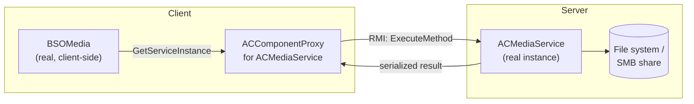

# iPlus Client-Server Components — Developer Guide

This guide explains how **client-server programming** works in the iPlus framework:
how a component on the client (desktop / browser / mobile) talks to the *real*
component instance on the server, how services are resolved, and which attributes
and conventions you must follow so that everything works across all UI platforms
(WPF, Avalonia desktop, Avalonia Browser/WASM, Android).

It is written for developers (and AI agents) who need to **add a new component**
without re-reading the whole framework source.

Reference implementation used throughout this document:
[ACMediaService.cs](../../gip.core.media/ACComponent/ACMediaService.cs) (server side),
[ACMediaController.cs](../../gip.core.media/ACComponent/ACMediaController.cs) (shared client-side logic with
local fallback), [MediaFileOperations.cs](../../gip.core.media/ACComponent/MediaFileOperations.cs) (file logic
shared by service and controller) and [BSOMedia.cs](../../gip.core.media/BSO/BSOMedia.cs) (UI business object).

---

## 0. Cheat sheet (TL;DR)

```text
1. Server component: derive from PARole (or PAJobScheduler), ACKinds.TPARole
2. Expose methods with [ACMethodInfo] + implement HandleExecuteACMethod switch
3. Return ONLY wire-safe DTOs: [ACSerializeableInfo] [DataContract] classes,
   primitives, string, byte[], enums. NEVER EF entities, Stream, Image, IntPtr.
4. Client resolves the service: PARole.GetServiceInstance<ACComponent>(this, "ACMyService")
   -> type it as ACComponent / IACComponent, NEVER as the concrete class: for a network
   service the result is an ACComponentProxy and the cast to ACMyService throws.
5. Configure the instance in the DB at ACUrl "\Service\ACMyService"
   (or "\LocalServiceObjects\ACMyService" for a local-only instance)
6. The returned object is an ACComponentProxy (network) or the real instance (service runs
   in this process). NEVER call the C# method directly (service.DoWork(...)). Always go
   through ExecuteMethod / ACUrlCommand, wrapped in a static method (see section 5.4).
   The runtime then does the remote call or the local dispatch. No plumbing code needed.
7. Browser/WASM: use ExecuteMethodAsync (or the "!`" ACUrl form) — the sync variants
   deadlock the single UI thread.
8. Keep an ACRef<T> to the service and Detach() it in ACDeInit.
9. Shared client logic (used by many BSOs) belongs in a controller/manager class
   (e.g. ACMediaController), not in the BSO. The BSO is UI-facing and calls the controller.
10. Offer a local fallback: if the service is unavailable (ConnectionState == DisConnected)
    and this is a desktop client that can reach the data directly (SMB share / mount),
    operate locally with a logic class shared by service and controller.
    Browser/Android have no local fallback.
```

---

## 1. Background — why proxies exist

iPlus applications are split into a **server process** (application tree, database,
managers, PA modules) and one or more **client processes** (UI). The client knows the
*metadata* (`ACClass`, `ACClassProperty`, `ACClassMethod`, `ACClassDesign`) from the
database. Depending on the platform it may also have the assemblies loaded (desktop),
but the **instance that owns the state lives on the server**.

When the client needs an object that lives on the server, the runtime creates a
**proxy** — an instance of `ACComponentProxy` that has the same `ACClass` metadata
but no real implementation. Every call on the proxy is forwarded to the server
instance over the RMI channel, executed there, and the result is serialized back.
This is what makes the same BSO code work on desktop, browser (WASM) and Android,
where the business assemblies are not available at all.



Key facts:

| Fact | Consequence for you |
|---|---|
| The proxy has the same `ACClass` as the real class | Attributes (`ACMethodInfo`, `ACPropertyInfo`) are available on both sides |
| Method bodies are **not** executed on the client | You cannot rely on client-side state inside a server method |
| Results are serialized | Only serializable types may cross the boundary |
| `IsProxy` is `true` on the proxy | Use it to branch behaviour when needed |
| The runtime handles transport | You write **no** network code |

---

## 2. Class kinds — what to derive from

| Base class | Base `ACKinds` | `ACKinds` for your derived class | Use for |
|---|---|---|---|
| `ACComponent` | `TACAbstractClass` | `TACClass` | Generic component |
| `ACBSO` | `TACAbstractClass` | `TACBSO` | Business object / screen logic (multi-instance) |
| `ACBSONav` | `TACAbstractClass` | `TACBSO` | Navigable BSO (adds `AccessNav`, `AutoFilter`, `AutoSaveOnDeInit`) |
| `ACBSOWizard` | `TACAbstractClass` | `TACBSO` | Wizard BSO (`Next`/`Prev`/`Cancel` commands) |
| `PARole` | `TACAbstractClass` | `TPARole` | **Service / manager** — the recommended base for client-server services |
| `PAJobScheduler` | `TPABGModule` | `TPABGModule` | Background module with job scheduling |
| `PABase` | `TACAbstractClass` | `TPABGModule` | Process module / workflow node |

The framework base classes themselves are declared `TACAbstractClass`; your
concrete class declares the concrete kind (`TACBSO`, `TPARole`, `TPABGModule`, …).

For a **service that the client reaches over the network**, derive from `PARole`
(or a subclass such as `PAJobScheduler`). `PARole` is poolable and is the class
that provides `GetServiceInstance<T>`.

```csharp
[ACClassInfo(Const.PackName_VarioSystem,
             "en{'Media Service'}de{'Media Service'}",
             Global.ACKinds.TPARole,
             Global.ACStorableTypes.NotStorable,
             false, false)]
public class ACMediaService : PARole
{
    public ACMediaService(ACClass acType, IACObject content, IACObject parentACObject,
                          ACValueList parameter, string acIdentifier = "")
        : base(acType, content, parentACObject, parameter, acIdentifier)
    {
    }
}
```

### `ACClassInfo` parameters

```csharp
ACClassInfo(
    string acPackageName,            // licensing package, e.g. Const.PackName_VarioSystem
    string acCaptionTranslation,     // "en{'...'}de{'...'}"
    Global.ACKinds acType,           // class category
    Global.ACStorableTypes acStorableType, // NotStorable / Optional / Required
    bool isMultiInstance,            // true => ACIdentifier gets "(1)", "(2)" suffix
    bool isRightmanagement,          // true => rights can be assigned per user/group
    ...)
```

There are overloads with `pwInfoACClass` (workflow compatibility), `acClassChilds`
(child declarations), `qryConfig` (default query for `ACBSONav`), `bsoConfig`
(entity → BSO mapping) and `sortIndex`.

---

## 3. Service resolution — `PARole.GetServiceInstance<T>`

This is the single most important API. It is defined in
[PARole.cs](../../gip.core.autocomponent/ACProcessApplication/ACPAClass/PARole.cs).

```csharp
public static T GetServiceInstance<T>(ACComponent requester,
                                      string acIdentifier,
                                      CreationBehaviour creationBehaviour = CreationBehaviour.Default)
    where T : IACComponent
```

### 3.1 Search order

| Step | Lookup | Notes |
|---|---|---|
| 1 | Child of `requester` with `ACIdentifier == acIdentifier` | With `FirstOrDefault`: also `FindChildComponents<T>()` |
| 2 | `\LocalServiceObjects\<acIdentifier>` | With `FirstOrDefault`: falls back to the class name and **auto-creates** the instance |
| 3 | `\Service\<acIdentifier>` | **Network service** — returns a proxy on the client. Skipped when `OnlyLocal` is set |

### 3.2 `CreationBehaviour` flags

```csharp
[Flags]
public enum CreationBehaviour
{
    Default        = 0x0,  // steps 1, 2, 3
    OnlyLocal      = 0x1,  // steps 1, 2 only — never a network service
    FirstOrDefault = 0x2,  // step 1/2 fall back to "any instance of type T", auto-create if missing
}
```

### 3.3 Recommended pattern

Resolve the configured service (local service object or network service):

```csharp
public const string C_DefaultServiceACIdentifier = "ACMediaService";
public const string DefaultServiceACUrl = "\\Service\\ACMediaService";

// Return type is ACComponent: for a network service the instance is an ACComponentProxy,
// a cast to ACMediaService would throw an InvalidCastException.
public static ACComponent GetServiceInstance(ACComponent requester)
{
    // child -> \LocalServiceObjects\ACMediaService -> \Service\ACMediaService
    return GetServiceInstance<ACComponent>(requester, C_DefaultServiceACIdentifier, CreationBehaviour.Default);
}
```

Do **not** use `CreationBehaviour.FirstOrDefault` as a "fallback" for a service that should
live on the server: it silently creates a local, unconfigured instance. Use the local
fallback described in section 5.4 instead.

For a **local-only** service (no server round-trip, e.g. printing on the client),
use `CreationBehaviour.OnlyLocal` — see
[ACPrintManager.cs](../../gip.core.reporthandler/Manager/ACPrintManager.cs).

### 3.4 Holding the reference — `ACRef<T>`

Never store a raw reference to a service across the component lifetime. Use
`ACRef<T>` (a smart pointer that attaches/detaches automatically):

```csharp
public static ACRef<ACMediaService> ACRefToServiceInstance(ACComponent requester)
{
    ACMediaService serviceInstance = GetServiceInstance(requester);
    if (serviceInstance != null)
        return new ACRef<ACMediaService>(serviceInstance, requester);
    return null;
}

public static void DetachACRefFromServiceInstance(ACComponent requester, ACRef<ACMediaService> acRef)
{
    if (acRef == null)
        return;
    acRef.Detach();
}
```

`ACRef<T>.RefInitMode` controls start/stop behaviour:
`NoInstantiation`, `AutoStart`, `AutoStop`, `AutoStartStop`.

---

## 4. Configuring the service in the database

The service instance must exist in the application tree. Two places are supported:

| ACUrl | Meaning | Created by |
|---|---|---|
| `\Service\<ACIdentifier>` | Network service — clients get a **proxy** | Configured in the DB (application tree / `ACClassTask`) |
| `\LocalServiceObjects\<ACIdentifier>` | Local service object — real instance in the client process | Configured in the DB, or auto-created by `FirstOrDefault` |

Constants live in
[LocalServiceObjects.cs](../../gip.core.autocomponent/ACIPlus/LocalServiceObjects/LocalServiceObjects.cs):

```csharp
public const string ClassName          = "LocalServiceObjects";
public const string ClassNameNetService = "Service";
```

> **Rule of thumb:** anything that touches the file system, the database or
> server-side hardware belongs at `\Service\...`. Anything that must run in the
> client process (file dialogs, printing, local temp files) belongs at
> `\LocalServiceObjects\...`.

---

## 5. Proxy mechanics — what happens on a method call

`ACComponentProxy` overrides `ExecuteMethod`, `ExecuteMethodAsync`,
`InvokeACUrlCommand`, `IsEnabledExecuteACMethod` and
`GetPropsToObserveForIsEnabled`. See
[ACComponentProxy.cs](../../gip.core.autocomponent/ACComponent/ACComponentProxy.cs).

### 5.1 Dispatch decision

```text
ExecuteMethod(name, args)
  ├─ ACClassMethod.ACKind == MSMethodClient     → execute LOCALLY (base.ExecuteMethod)
  ├─ ACClassMethod.ACKind == MSMethodExtClient  → execute LOCALLY
  ├─ IsACComponentMethod(name)                  → execute LOCALLY
  └─ otherwise                                  → RMInvoker.ExecuteMethod(...)  → SERVER
```

`IsACComponentMethod` covers framework methods such as `OpenHelp`, `PrintSelf`,
`CloseTopDialog`, `GetACUrl`, `GetMenu`, `FindChildComponents`, `Stop`, …

### 5.2 Sync vs. async — **critical for Browser/WASM**

| Variant | Behaviour | When to use |
|---|---|---|
| `ExecuteMethod(...)` | Blocks the calling thread until the server answers | Desktop only |
| `ExecuteMethodAsync(...)` | Returns a `Task<object>` | **Always on Browser/WASM**, recommended everywhere |
| `ACUrlCommand("!Method", args)` | Sync | Desktop only |
| ``ACUrlCommand("!`Method", args)`` | Async invocation (`ACUrlHelper.CallAsync = "!`"`) | Browser/WASM |

There is no separate `ACUrlCommandAsync` method. The async form is expressed in the
ACUrl itself with the `` ` `` delimiter: ``!`Method`` is routed to
`ExecuteMethodAsync`. `ACCommand.GetAsyncACUrl()` performs exactly this rewrite
(`!` → `` !` ``) for commands declared in the database.

On WASM there is a **single UI thread**. A blocking wait can never be satisfied
because the response can only be delivered when the UI thread keeps pumping its
event loop → deadlock. The framework installs a pumping hook
(`ACObjectRMInvoker.PumpingWaitHook`) to mitigate this, but the correct fix is to
use the async API.

> **Ask-User handlers are not invoked on the async path.** If your method needs an
> `AskUser...` confirmation, keep it on the sync path (desktop) or implement the
> confirmation on the client side.

### 5.3 Proxy creation

`ACComponent.StartComponent(acClass, content, parameterList, startChildMode, asProxy: true, acIdentifier)`
chooses the proxy type:

| Real class | Proxy type |
|---|---|
| Workflow type (`acClass.IsWorkflowType`) | `PWNodeProxy` |
| `ACKinds.TACApplicationManager` | `ApplicationManagerProxy` |
| everything else | `ACComponentProxy` |

### 5.4 Calling a service correctly — static wrappers, controller, local fallback

**Rule: never call the C# method on the service reference.** The reference is either an
`ACComponentProxy` (the method body does not exist on the client) or the real instance
(service started inside the UI process). Only `ExecuteMethod` / `ACUrlCommand` decide
between "remote invocation" and "direct dispatch via `HandleExecuteACMethod`".

```csharp
// WRONG: fails or does nothing when 'service' is a proxy
MediaContentResult r = mediaService.GetFileContent(path);

// RIGHT: static wrapper that goes through ExecuteMethod (see ACRoutingService.FindSuccessors)
public static MediaContentResult InvokeGetFileContent(IACComponent service, string filePath)
{
    return service.ExecuteMethod(nameof(GetFileContent), filePath) as MediaContentResult;
}
```

The pattern as implemented for media, from top to bottom:

| Layer | Class | Responsibility |
|---|---|---|
| UI business object | `BSOMedia` | Presentation, selection, temp files for display. Calls **only** the controller. |
| Shared client logic | `ACMediaController` | Used by many BSOs. Resolves the service (`ACRef<ACComponent>`), checks `IsMediaServiceAvailable`, calls the static wrappers, falls back to local access. |
| Proxy-safe invocation | `ACMediaService.Invoke...` (static) | `service.ExecuteMethod(nameof(X), args)` |
| Server component | `ACMediaService` (`PARole`) | `[ACMethodInfo]` methods + `HandleExecuteACMethod`. Thin: delegates to the file logic. |
| Shared file logic | `MediaFileOperations` (plain class) | All file access. Used by the service and by the controller's local fallback. |

Availability check, same idea as `IsRoutingServiceAvailable`
([BSORouteSelector.cs](../../gip.bso.iplus/Routing/BSORouteSelector.cs)):

```csharp
public bool IsMediaServiceAvailable =>
    MediaService != null && MediaService.ConnectionState != ACObjectConnectionState.DisConnected;
```

Decision logic of every controller method (`CallMediaService` in
[ACMediaController.cs](../../gip.core.media/ACComponent/ACMediaController.cs)):

1. Service available → invoke remotely via the static wrapper. On an exception, log and continue with 2.
2. Service unavailable, **desktop** client (not Browser/Android/iOS) and the data root is reachable
   (`Directory.Exists` on the SMB share or Linux mount) → call the shared logic class directly.
3. Otherwise → return a failed result (`Success = false` + `Msg`), never throw to the UI.

Keep the stored data identical in both paths (e.g. media paths are stored **relative** to the
media root, so a Windows client with `\\server\media` and a Linux client with `/mnt/media` see the same data).

---

## 6. Wire-safe data — what may cross the boundary

Everything returned from a server method (and every parameter passed to it) is
serialized. **Only these types are safe:**

| Category | Examples |
|---|---|
| Primitives | `bool`, `int`, `long`, `double`, `decimal`, `string`, `DateTime`, `Guid` |
| Nullables of the above | `int?`, `DateTime?` |
| Enums | any `enum` (registered automatically) |
| Arrays | `byte[]`, `string[]`, `object[]` |
| Framework types | `Msg`, `ACValueList`, `ACMethod`, `ACClass`, `ACClassProperty`, `ACClassMethod` |
| Your own DTOs | classes marked `[ACSerializeableInfo]` + `[DataContract]` |

**Never** return: EF entities (`ProdOrderBatchPlan`, …), `Stream`, `Image`,
`Bitmap`, `IntPtr`, delegates, or anything holding a live DB context.

### 6.1 Writing a DTO

```csharp
[ACSerializeableInfo]
[DataContract]
[ACClassInfo(Const.PackName_VarioSystem,
             "en{'MediaContentResult'}de{'MediaContentResult'}",
             Global.ACKinds.TACSimpleClass)]
public class MediaContentResult
{
    [IgnoreDataMember]
    private byte[] _Content;
    [DataMember]
    public byte[] Content
    {
        get { return _Content; }
        set { _Content = value; }
    }

    [DataMember]
    public string FileName { get; set; }

    [DataMember]
    public string Extension { get; set; }

    [DataMember]
    public string MimeType { get; set; }

    [DataMember]
    public bool Success { get; set; }

    [DataMember]
    public string Msg { get; set; }
}
```

Only members marked `[DataMember]` are serialized. The private backing fields are
an implementation detail and are explicitly excluded with `[IgnoreDataMember]`, so
the wire contract stays explicit and cannot accidentally grow.

### 6.2 How registration works

`ACClassManager.RegisterSingleType` scans every registered class for
`[ACSerializeableInfo]` and calls `ACKnownTypes.RegisterUnKnownType(type)` (or the
types listed in `ACSerializeableInfo.TypeList`). See
[ACKnownTypes.cs](../../gip.core.datamodel/ACSerialization/ACKnownTypes.cs).

Primitives, nullables, `Guid`, `TimeSpan`, `DateTime`, `eMsgLevel`, `eMsgButton`
and `object[]` are registered in the static constructor of `ACKnownTypes`.
`byte[]` is registered as a known message type in
[WCFMessage.cs](../../gip.core.autocomponent/ACIPlus/Communications/WCFMessage.cs) (line 82).

> **If a type is not registered, the call fails at runtime with a serialization
> error** — usually only on the client, not on the server. Always test the client
> path.

### 6.3 Binary content

For files, images, PDFs etc. return `byte[]` plus format metadata — **not** a
`Stream` and **not** a UI image object. The client decides how to materialize it
(write a temp file, create a `Bitmap`, hand it to a browser blob, …).

---

## 7. Declaring methods

### 7.1 Attribute family

| Attribute | Purpose |
|---|---|
| `ACMethodInfo` | Generic method (server-side by default) |
| `ACMethodCommand` | `void`, parameterless — appears as a button |
| `ACMethodInteraction` | Appears in the context menu |
| `ACMethodClient` | **Static**, first parameter `IACComponent acComponent` — runs on the **client** |
| `ACMethodInteractionClient` | Client-side context-menu method |
| `ACMethodAttached` | Static client method attached to another class (extension-method concept) |
| `ACMethodAsync` | Async process method: `ACMethodEventArgs MethodName(ACMethod acMethod)` |
| `ACMethodState` | `void`, parameterless, tied to an `ACState` state machine |

> There is **no** `ACMethodExt` attribute. Script/extension methods are ordinary
> methods whose `ACClassMethod.ACKind` is set to `MSMethodExt` / `MSMethodExtClient`
> in the database (e.g. created in the development environment).

```csharp
[ACMethodInfo(string acGroup,
              string acCaptionTranslation,
              Int16 sortIndex,
              bool isRightmanagement = false,
              Global.ACKinds acKind = Global.ACKinds.MSMethod,
              bool isAsyncProcess = false,
              bool isPeriodic = false)]
```

Additional settable properties:

| Property | Meaning |
|---|---|
| `IsRPCEnabled` | Method may be delegated to a remote device |
| `Description` | Free text; used by the MCP/LLM tooling |
| `AttachToClass` | Extension-method target class |
| `ContextMenuCategoryIndex` | Context-menu grouping (`Global.ContextMenuCategory`) |

### 7.2 Server-side method example

```csharp
[ACMethodInfo("", "en{'Get file content'}de{'Dateiinhalt lesen'}", 300)]
public MediaContentResult GetFileContent(string filePath)
{
    return ReadContent(filePath);
}
```

### 7.3 Client-side method example

A client method is `static`, takes `IACComponent acComponent` as first parameter,
and typically collects client-only input (file dialog, clipboard) before calling
the server method:

```csharp
[ACMethodInteractionClient("", "en{'Restart Delegate-Queue'}de{'Restart Delegate-Queue'}", 111, false, "", false)]
public static void RestartDelegateQueueC(IACComponent acComponent)
{
    ACComponent _this = acComponent as ACComponent;
    string id = _this.Messages.InputBox("Enter ID of Delegate-Queue for restarting", "");
    if (String.IsNullOrWhiteSpace(id))
        return;
    _this.ACUrlCommand("!RestartDelegateQueue", id);
}
```

### 7.4 `HandleExecuteACMethod` — the dispatch switch

Every `ACComponent` routes incoming method calls through
`HandleExecuteACMethod`. You **must** override it and add a `case` per method,
otherwise the call silently returns `null`:

```csharp
protected override bool HandleExecuteACMethod(out object result,
                                              AsyncMethodInvocationMode invocationMode,
                                              string acMethodName,
                                              ACClassMethod acClassMethod,
                                              params object[] acParameter)
{
    result = null;
    switch (acMethodName)
    {
        case nameof(GetFileContent):
            result = GetFileContent(acParameter[0] as string);
            return true;
        case nameof(GetFiles):
            result = GetFiles(acParameter[0] as string, acParameter[1] as string,
                              (MediaItemTypeEnum)acParameter[2], (int)acParameter[3],
                              acParameter[4] as string, acParameter[5] as string,
                              (bool)acParameter[6]);
            return true;
        case nameof(UploadFile):
            result = UploadFile(acParameter[0] as string, acParameter[1] as string,
                                (MediaItemTypeEnum)acParameter[2], acParameter[3] as string,
                                acParameter[4] as byte[], (bool)acParameter[5],
                                (bool)acParameter[6], acParameter[7] as byte[]);
            return true;
    }
    return base.HandleExecuteACMethod(out result, invocationMode, acMethodName, acClassMethod, acParameter);
}
```

> **Always call `base.HandleExecuteACMethod`** at the end — it handles the
> framework methods (`ACPostInit`, `Stop`, `GetACUrl`, …).

---

## 8. Properties

### 8.1 Attribute family

| Attribute | `ACPropUsages` | Purpose |
|---|---|---|
| `ACPropertyInfo` | `Property` | Plain property |
| `ACPropertyCurrent` | `Current` | Current item of a group |
| `ACPropertySelected` | `Selected` | Selected item of a group |
| `ACPropertyList` | `List` | List belonging to a group |
| `ACPropertyConfig` | `Configuration` | Configuration value (DB `ACClassConfig`) |
| `ACPropertyBindingSource` | `Property` | Source of a property binding (server → client) |
| `ACPropertyBindingTarget` | `Property` | Target of a property binding |
| `ACPropertyEntity` | `Property` | Property backed by an EF entity |

```csharp
[ACPropertyInfo(Int16 sortIndex,
                string acGroup = "",
                string acCaptionTranslation = "",
                string acSource = "",
                bool isRightmanagement = false)]
```

`acGroup` ties `List`/`Selected`/`Current` together. `acSource` is the ACUrl of an
`ItemsSource` when the property is shown in an items control.

### 8.2 Configuration values — `ACPropertyConfigValue<T>`

Configuration values are read from `ACClassConfig` in the database, with a
fallback default in code:

```csharp
private ACPropertyConfigValue<string> _MediaRootFolder;

public BSOMedia(...)
    : base(...)
{
    _MediaRootFolder = new ACPropertyConfigValue<string>(
        this, MediaSettings.GetMediaRootConfigName(), string.Empty);
}

[ACPropertyConfig("MediaRootFolder")]
public string MediaRootFolder
{
    get { return _MediaRootFolder.ValueT; }
    set { _MediaRootFolder.ValueT = value; }
}
```

**Important:** `ValueT` is loaded lazily. Touch the property once in `ACInit`
(`_ = MediaRootFolder;`) so the value is materialized before it is needed.

### 8.3 Network properties — source / target

For values that must be synchronized between server and client, declare them as
`ACPropertyBindingSource` / `ACPropertyBindingTarget`:

```csharp
[ACPropertyBindingSource(200, "", "en{'State general'}de{'Zustand Allgemein'}",
                         "", true, true, DefaultValue = ACStateEnum.SMIdle, RemotePropID = 13)]
public IACContainerTNet<ACStateEnum> ACState { get; set; }
```

The framework creates `ACPropertyNetSource<T>` on the server and
`ACPropertyNetTarget<T>` on the proxy, and keeps them in sync. `IsProxyProperty`
on the attribute selects the target variant.

### 8.4 Child components — `ACChildItem<T>`

For lazily created child BSOs:

```csharp
ACChildItem<BSOFacilityExplorer> _BSOFacilityExplorer_Child;

[ACPropertyInfo(600)]
[ACChildInfo(nameof(BSOFacilityExplorer_Child), typeof(BSOFacilityExplorer))]
public ACChildItem<BSOFacilityExplorer> BSOFacilityExplorer_Child
{
    get
    {
        if (_BSOFacilityExplorer_Child == null)
            _BSOFacilityExplorer_Child = new ACChildItem<BSOFacilityExplorer>(this, nameof(BSOFacilityExplorer_Child));
        return _BSOFacilityExplorer_Child;
    }
}
```

`ACChildItem<T>.Value` resolves the child by `?<InstanceName>`, then by type, then
starts it.

---

## 9. Lifecycle

| Method | When | Typical work |
|---|---|---|
| `ACInit(Global.ACStartTypes startChildMode)` | Instance creation | Create `ACPropertyConfigValue<T>`, resolve services, subscribe to points |
| `ACPostInit()` | After all children are initialized | Load data, hook `Database.ChangeTracker`, start background work |
| `ACDeInit(bool deleteACClassTask)` | Instance destruction | `Detach()` refs, unsubscribe, dispose |

```csharp
public override bool ACInit(Global.ACStartTypes startChildMode = Global.ACStartTypes.Automatic)
{
    if (!base.ACInit(startChildMode))
        return false;

    _ = MediaRootFolder;                       // force config load
    MediaController = ACMediaController.GetServiceInstance(this);
    MediaService    = ACMediaService.GetServiceInstance(this);
    return true;
}

public override async Task<bool> ACDeInit(bool deleteACClassTask = false)
{
    _MediaRootFolder = null;
    return await base.ACDeInit(deleteACClassTask);
}
```

`ACBSO` adds `VerifyLicense()`, a task subscription point and the background
worker (`InitBgWorker()`); `ACBSONav` adds navigation and auto-save handling.

---

## 10. ACUrl syntax

An ACUrl addresses a component, a property or a method. Delimiters are defined in
[ACUrlHelper.cs](../../gip.core.datamodel.shared/ACHelperclasses/ACUrl/ACUrlHelper.cs).

| Delimiter | Meaning | Example |
|---|---|---|
| `\` | Child | `\Service\ACMediaService` |
| `.` | Relative path | `.\Child` |
| `..` | Parent | `..\Sibling` |
| `?` | Exists (returns the instance or `null`) | `?BSOMaterial` |
| `#` | Start component | `#BSOMaterial` |
| `~` | Stop component | `~BSOMaterial` |
| `!` | Invoke method | `!Save` |
| `` ` `` | Async invocation | ``!`Save`` |
| `§` | Translation text | `§MyKey` |
| `^` | Custom message | `^MyMessage` |
| `(` `)` | Instance number | `BSOMaterial(1)` |
| `\|\|` | Relationship | `A\|\|B` |
| `@` | Attached method | `Method@Class` |

These characters are **reserved** and must not appear in an `ACIdentifier`.

Common framework commands (see `Const.cs`):

```csharp
Const.CmdNew      = "!New"
Const.CmdDelete   = "!Delete"
Const.CmdSave     = "!Save"
Const.CmdUndoSave = "!UndoSave"
Const.CmdSearch   = "!Search"
```

`ACUrlCommand` handles `Root`, `Child`, `Parent`, `Start`, `Stop`,
`InvokeMethod`, `CustomMessage` and `TranslationText`. On a proxy, config values
are forwarded via `InvokeACUrlCommand`.

---

## 11. IsEnabled — keeping buttons in sync

A button bound to `VBContent="!MyMethod"` is enabled/disabled by
`IsEnabledMyMethod()`. The UI layer
([ACCommandHelper.cs](../../gip.core.layoutengine.avui/Helperclasses/ACCommandHelper.cs))
needs to know **which properties to observe** so it can re-evaluate the state.

### 11.1 The mechanism

```text
ACCommandHelper.ApplyACCommand(...)
  → interactiveObject.GetPropsToObserveForIsEnabled(methodName)
      ├─ non-empty  → ReactiveCommand observing those properties
      └─ empty/null → CommandBinding / CanExecuteRoutedEventHandler fallback
```

`ACComponent.GetPropsToObserveForIsEnabled` returns `null` by default.
`ACComponentProxy` forwards the call to the server via
`RMInvoker.ExecuteMethod(nameof(GetPropsToObserveForIsEnabled), ...)`.

### 11.2 Override it in your BSO

```csharp
private static readonly string[] MediaItemSelectionProps = new string[]
{
    nameof(ActiveTab), nameof(SelectedImage), nameof(SelectedDocument),
    nameof(SelectedAudio), nameof(SelectedVideo)
};

public override IEnumerable<string> GetPropsToObserveForIsEnabled(string acMethodName)
{
    switch (acMethodName)
    {
        case nameof(SetFilePath):
        case nameof(IsEnabledSetFilePath):
        case nameof(UploadFile):
        case nameof(IsEnabledUploadFile):
        case nameof(Delete):
        case nameof(IsEnabledDelete):
            return MediaItemSelectionProps;
    }
    return base.GetPropsToObserveForIsEnabled(acMethodName);
}
```

### 11.3 Rules that make it work

1. **Every name must resolve** via `ACUrlTypeInfo` — i.e. the property must be
   declared with `[ACPropertyInfo]` / `[ACPropertyCurrent]` / `[ACPropertySelected]` /
   `[ACPropertyList]` and must raise `PropertyChanged`.
2. **Unresolvable names are silently dropped** — the button then never refreshes.
   This is the #1 cause of "stuck" buttons.
3. **List-derived conditions** (e.g. "enabled if any row is selected") need a
   *version counter* property that you bump whenever the list changes, and that
   counter must be in the observed list. Example: `ProdOrderBatchPlanSelectionVersion`.
4. **`IsEnabled` convention:** `Const.IsEnabledPrefix = "IsEnabled"`. If a method
   `IsEnabledX` exists, `ACClassManager` sets `IsAutoenabled = false` for `X`.
5. **On a proxy** the observed-property query goes to the server — the properties
   must therefore exist on the server class, not only on the client.

---

## 12. Messages and logging

Use the `Messages` API ([Messages.cs](../../gip.core.autocomponent/ACIPlus/Messages/Messages.cs)):

```csharp
// user-facing popups
await Messages.WarningAsync(this, "Error50801", false, arg0);
await Messages.ErrorAsync(this, "Error50801", false, arg0);

// log only
Messages.LogWarning(this.GetACUrl(), nameof(ACInit), "Media root folder is not configured.");
Messages.LogException(this.GetACUrl(), nameof(ACInit), ex, true);
```

Error texts are stored in `ACClassMessage` and referenced by key — see
[iplus-messages-workflow.md](../iplus-messages-workflow.md) for the full workflow.

---

## 13. Locking — `ACMonitor` and lock hierarchies

Never use `lock(this)` or a plain `object` for synchronization. Use
`ACMonitorObject` with a **5-digit level** — see
[ACMonitor.cs](../../gip.core.datamodel/ACHelperclasses/ThreadHandling/ACMonitor.cs):

```csharp
private ACMonitorObject _20020_LockMemberList = new ACMonitorObject(20020);

using (ACMonitor.Lock(_20020_LockMemberList))
{
    // ...
}
```

The first digit encodes the assembly layer:

| Level | Layer |
|---|---|
| `10xxx` | `gip.core.datamodel` |
| `11xxx` | `gip.mes.datamodel` |
| `20xxx` | `gip.core.autocomponent` |
| `30xxx` | `gip.core.communication` |
| `40xxx` | managers |
| `60xxx` | process application |
| `70xxx` | BSO |

**Rule:** a lower-level lock must never be acquired while holding a higher-level
lock. Violations throw `SynchronizationLockException` in the debugger and log the
stack trace otherwise. Controlled by `CoreConfiguration` switches
`ValidateLockHierarchies` and `UseSimpleMonitor`.

---

## 14. Complete example — a new service in 8 steps

### Step 1 — DTO

```csharp
[ACSerializeableInfo]
[DataContract]
[ACClassInfo(Const.PackName_VarioSystem, "en{'MyResult'}de{'MyResult'}", Global.ACKinds.TACSimpleClass)]
public class MyResult
{
    [DataMember] public bool Success { get; set; }
    [DataMember] public string Msg { get; set; }
    [DataMember] public byte[] Content { get; set; }
}
```

### Step 2 — Service class

```csharp
[ACClassInfo(Const.PackName_VarioSystem, "en{'My Service'}de{'My Service'}",
             Global.ACKinds.TPARole, Global.ACStorableTypes.NotStorable, false, false)]
public class ACMyService : PARole
{
    public const string C_DefaultServiceACIdentifier = "ACMyService";
    public const string DefaultServiceACUrl = "\\Service\\ACMyService";

    public ACMyService(ACClass acType, IACObject content, IACObject parentACObject,
                       ACValueList parameter, string acIdentifier = "")
        : base(acType, content, parentACObject, parameter, acIdentifier)
    {
    }

    public override bool ACInit(Global.ACStartTypes startChildMode = Global.ACStartTypes.Automatic)
    {
        if (!base.ACInit(startChildMode))
            return false;
        // load configuration, check environment
        return true;
    }

    // ACComponent, not ACMyService: on a client this is an ACComponentProxy
    public static ACComponent GetServiceInstance(ACComponent requester)
    {
        return GetServiceInstance<ACComponent>(requester, C_DefaultServiceACIdentifier, CreationBehaviour.Default);
    }

    // proxy-safe wrapper: remote call on a proxy, direct dispatch on the real instance
    // (ExecuteMethodAsync is declared on ACComponent; IACComponent only has the sync ExecuteMethod)
    public static async Task<MyResult> DoWorkAsync(ACComponent service, string input)
    {
        return await service.ExecuteMethodAsync(nameof(DoWork), input) as MyResult;
    }

    [ACMethodInfo("", "en{'Do work'}de{'Arbeit ausführen'}", 100)]
    public MyResult DoWork(string input)
    {
        return new MyResult { Success = true, Content = Encoding.UTF8.GetBytes(input) };
    }

    protected override bool HandleExecuteACMethod(out object result,
                                                  AsyncMethodInvocationMode invocationMode,
                                                  string acMethodName,
                                                  ACClassMethod acClassMethod,
                                                  params object[] acParameter)
    {
        result = null;
        switch (acMethodName)
        {
            case nameof(DoWork):
                result = DoWork(acParameter[0] as string);
                return true;
        }
        return base.HandleExecuteACMethod(out result, invocationMode, acMethodName, acClassMethod, acParameter);
    }
}
```

### Step 3 — Consumer (client side)

```csharp
public class BSOMyConsumer : ACBSO
{
    private ACRef<ACComponent> _MyService;
    public ACComponent MyService => _MyService?.ValueT;

    public override bool ACInit(Global.ACStartTypes startChildMode = Global.ACStartTypes.Automatic)
    {
        if (!base.ACInit(startChildMode))
            return false;
        ACComponent service = ACMyService.GetServiceInstance(this);
        if (service != null)
            _MyService = new ACRef<ACComponent>(service, this);
        return true;
    }

    public override async Task<bool> ACDeInit(bool deleteACClassTask = false)
    {
        _MyService?.Detach();
        _MyService = null;
        return await base.ACDeInit(deleteACClassTask);
    }

    public async Task CallServiceAsync()
    {
        if (MyService == null)
            return;
        MyResult result = await ACMyService.DoWorkAsync(MyService, "hello");
        if (result == null || !result.Success)
            await Messages.ErrorAsync(this, result?.Msg ?? "Service call failed.");
    }
}
```

### Step 4 — Register the class

Start the application once with the development login so that `ACClassManager`
registers the new `ACClass`, its methods and properties in the database.

### Step 5 — Configure the instance

Create the instance in the application tree at `\Service\ACMyService`
(or `\LocalServiceObjects\ACMyService` for a local-only service).

### Step 6 — Verify the proxy

On the client, check `MyService.IsProxy` — it must be `true` when the service is
configured as a network service.

### Step 7 — Test all platforms

| Platform | What to check |
|---|---|
| Desktop | Sync and async calls |
| Browser/WASM | **Async only** — verify no deadlock |
| Android | Async only, verify DTO serialization |

### Step 8 — Test the failure path

Stop the server or remove the configuration and verify that the consumer degrades
gracefully (null check, warning message) instead of throwing.

---

## 15. Pitfalls checklist

- [ ] **DTO not registered** → `[ACSerializeableInfo]` missing → serialization error on the client only.
- [ ] **EF entity returned** → serialization failure or stale data. Map to a DTO.
- [ ] **`Stream` / `Image` returned** → not serializable. Return `byte[]` + format info.
- [ ] **`HandleExecuteACMethod` case missing** → method returns `null` silently.
- [ ] **`base.HandleExecuteACMethod` not called** → framework methods break.
- [ ] **Sync call on WASM** → deadlock. Use `ExecuteMethodAsync` or the `` !` `` ACUrl form.
- [ ] **`AskUser` handler on async path** → not invoked. Keep confirmations client-side.
- [ ] **C# method called on the service reference** (`service.DoWork()`) → fails on a proxy. Use a static wrapper around `ExecuteMethod` / `ACUrlCommand`.
- [ ] **Service typed as the concrete class** (`GetServiceInstance<ACMyService>`) → `InvalidCastException` for a proxy. Use `ACComponent` / `IACComponent`.
- [ ] **Shared client logic placed in the BSO** → duplicated in every BSO. Put it in a controller/manager.
- [ ] **No fallback when the service is down** → add the local fallback for desktop clients (section 5.4).
- [ ] **Raw service reference stored** → use `ACRef<T>` and `Detach()` in `ACDeInit`.
- [ ] **`ACPropertyConfigValue<T>` not touched in `ACInit`** → value stays at default.
- [ ] **`GetPropsToObserveForIsEnabled` names unresolvable** → buttons never refresh.
- [ ] **List-derived `IsEnabled` without a version counter** → buttons stay stale.
- [ ] **`lock(this)` / plain `object`** → use `ACMonitorObject` with a correct level.
- [ ] **Reserved ACUrl characters in an `ACIdentifier`** → URL parsing breaks.
- [ ] **Service configured only locally** → clients get `null`; configure `\Service\...`.

---

## 16. Reference implementations in the framework

| Pattern | Class | Notes |
|---|---|---|
| Server-side service with `byte[]` DTOs | [ACMediaService.cs](../../gip.core.media/ACComponent/ACMediaService.cs) | `\Service\ACMediaService`, `Invoke...` static wrappers |
| Shared client logic + local fallback | [ACMediaController.cs](../../gip.core.media/ACComponent/ACMediaController.cs) | `CallMediaService`, `IsMediaServiceAvailable`, `IsLocalAccessAvailable` |
| Shared file logic (service + fallback) | [MediaFileOperations.cs](../../gip.core.media/ACComponent/MediaFileOperations.cs) | Plain class, relative paths |
| UI business object | [BSOMedia.cs](../../gip.core.media/BSO/BSOMedia.cs) | Calls only the controller, temp-file materialization |
| Local-only service | [ACPrintManager.cs](../../gip.core.reporthandler/Manager/ACPrintManager.cs) | `CreationBehaviour.OnlyLocal` |
| `\Service\...` component with dispatch switch | [ACRoutingService.cs](../../gip.core.autocomponent/Routing/ACRoutingService.cs) | `PAJobScheduler` base, `HandleExecuteACMethod` |
| Proxy implementation | [ACComponentProxy.cs](../../gip.core.autocomponent/ACComponent/ACComponentProxy.cs) | `ExecuteMethod`, `ExecuteMethodAsync`, `InvokeACUrlCommand` |
| Service resolution | [PARole.cs](../../gip.core.autocomponent/ACProcessApplication/ACPAClass/PARole.cs) | `GetServiceInstance<T>`, `CreationBehaviour` |
| Client-side method | [RuntimeDump.cs](../../gip.core.autocomponent/ACIPlus/Environment/RuntimeDump.cs) | `ACMethodInteractionClient` static method |
| Child component | [BSOFacilityInventory.cs](../../../iPlusMES/gip.bso.facility/FacilityBooking/BSOFacilityInventory.cs) | `ACChildItem<T>` + `ACChildInfo` |

---

## 17. Further reading

- Online documentation: <https://iplus-framework.com/en/documentation/Read/Index/6a220db6-a767-40bb-bf95-395e4a289881?workspaceSchemaID=bce1702a-7637-4b98-83db-01a9d7a3a156>
  (configuration schema, `CoreConfiguration`, logging, `ACMonitor` lock hierarchies)
- [iplus-messages-workflow.md](../iplus-messages-workflow.md) — error messages and `ACClassMessage`
- [add-iplusV4-dbfield.md](../add-iplusV4-dbfield.md) — adding a DB field to an entity
- [iplus-licensing-and-packaging.md](./iplus-licensing-and-packaging.md) — license files,
  enforcement points, GPL/commercial package metadata, NuGet packing and binary publishing
