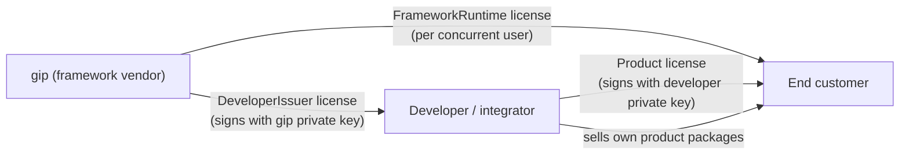
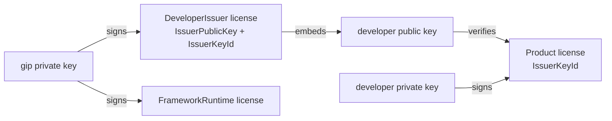
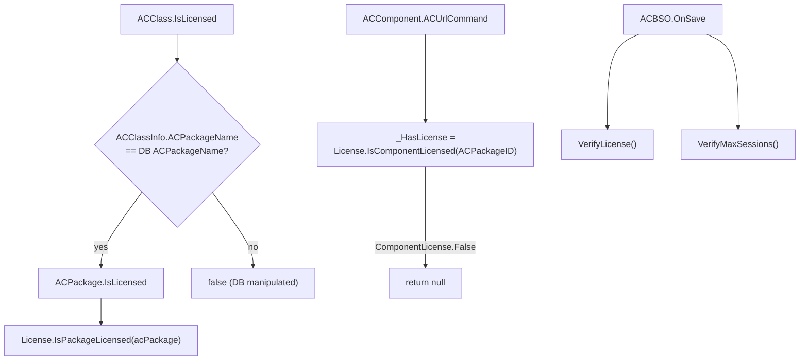
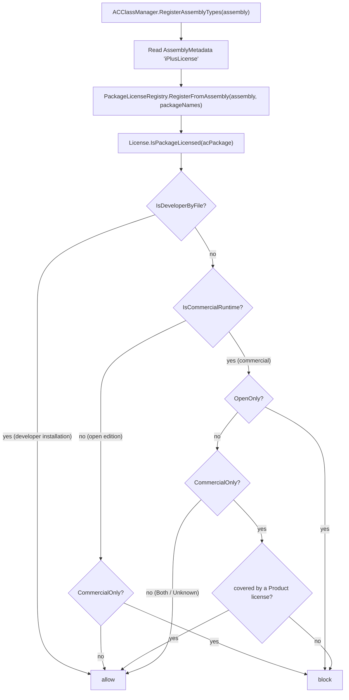

# iPlus Licensing & Packaging — Developer Guide

This guide explains how **licensing** and **packaging** work in iPlus V5: how a license
file is issued, verified and enforced at runtime, how a package declares its license
(GPL vs. commercial), and how the NuGet / binary distribution pipelines are wired.

It is written for developers (and AI agents) who need to **add a commercial product
package**, **issue licenses**, or **change the build/publish pipeline** without
re-reading the whole framework source.

Reference implementations used throughout this document:
[License.cs](../../gip.core.datamodel/ACHelperclasses/ACLicense/License.cs),
[License.FileLicensing.cs](../../gip.core.datamodel/ACHelperclasses/ACLicense/License.FileLicensing.cs)
and [gip.core.licensing/](../../gip.core.licensing/readme.md).

---

## 0. Cheat sheet (TL;DR)

```text
1. FOUR license kinds: DeveloperIssuer (10), DeveloperEndUser (20), Product (30),
   FrameworkRuntime (40). FrameworkRuntime is the commercial iPlus edition, sold per
   concurrent user (MaxUsers). A Product license is only effective when a
   FrameworkRuntime license is present.
2. License files are *.gip: "IPLUS-LICENSE" + base64 RSA-SHA256 signature + JSON payload.
   The signature covers the exact UTF-8 bytes of the JSON — no canonicalization.
3. Verification is OFFLINE and stateless: LicenseVerifier.Verify(text, context).
   Framework key resolution: env IPLUS_LICENSE_PUBLIC_KEY -> embedded resource -> file.
4. Two-level PKI chain: gip signs DeveloperIssuer (embeds the developer's public key +
   IssuerKeyId); the developer signs Product with the matching private key. A developer
   cannot issue a DeveloperIssuer license for itself.
5. Runtime bridge: License.FileLicensing.cs. It scans <appbase>/Licenses/*.gip AND
   re-verifies rows activated into VBSystem (SystemName "VBP" = product/runtime,
   "VBD" = issuer). Dedupe key is LicenseId, NOT CustomerName.
6. Enforcement points: ACPackage.IsLicensed -> ACClass.IsLicensed -> ACComponent.ACUrlCommand
   (_HasLicense) and ACBSO.OnSave -> VerifyLicense/VerifyMaxSessions.
7. Package license metadata: AssemblyMetadata("iPlusLicense", "<SPDX expression>").
   Read once in ACClassManager.RegisterAssemblyTypes -> PackageLicenseRegistry.
8. <GenerateAssemblyInfo>false</GenerateAssemblyInfo> is set in ALL projects, so the SDK's
   <AssemblyAttribute> item DOES NOT WORK. Use the GenerateIPlusLicenseAttribute target.
9. Mixing rule: a package may run under a commercial runtime license only if its
   expression contains "Commercial" or is permissive (MIT/Apache-2.0/BSD-3-Clause).
   Pure GPL-3 packages are blocked under a commercial runtime; commercial-only packages
   are blocked under the open runtime. A developer installation (DeveloperIssuer /
   DeveloperEndUser license file) is exempt: everything may run there.
10. Grace period: 30 min client warning, then ACUrlCommand blocked after 1.5 days.
    Tracked by LicenseGracePeriod (gip.core.licensing), persisted in
    <LicenseFolder>/.licensegrace so a restart does not reset the clock.
11. Pack: build/pack-local.sh -> ./local-packages (PackageId = iPlus.<ProjectName>).
    Publish: build/publish-release.sh -> ./artifacts/release (binaries, not packages).
```

---

## 1. Background — the three-division model

V4 used a hardware dongle (TDi Matrix32/Matrix64, driven through `Mxapi.cs`). V5 replaces it
with **offline signed license files** while keeping the same three-division semantics. The
dongle code path has been **removed entirely** — `Mxapi.cs`, `Mxtea.cs`, `matrix.ini`, the
`#region Dongle-Operations` in `License.cs`, and the `gip.tool.devLicense` /
`gip.tool.devLicenseProvider` projects are gone. `License.Initialize()` no longer probes for
hardware, which is why the runtime now starts on Linux/macOS.



| Division | Who | What they get |
|---|---|---|
| gip | framework vendor | Signs `DeveloperIssuer` and `FrameworkRuntime` licenses |
| developer / integrator | builds product packages | Holds a `DeveloperIssuer` license → may issue `Product` licenses for **their own** packages |
| end customer | runs the installation | Holds a `Product` license per developer product **and** a `FrameworkRuntime` license per concurrent user |

**Key business rule:** a product license is worthless without a framework runtime
license. The runtime license is what the end customer buys from gip; the product
license is what they buy from the integrator.

---

## 2. The licensing library — `gip.core.licensing`

Deliberately **dependency-free** (BCL only) so it can be consumed by
`gip.core.datamodel`, the issuer CLI and third-party commercial modules without
dragging in EF Core / Avalonia / SqlClient.

| Type | Purpose |
|---|---|
| `LicenseKind` | `Unknown=0`, `DeveloperIssuer=10`, `DeveloperEndUser=20`, `Product=30`, `FrameworkRuntime=40` |
| `LicensePayload` | The signed data: `FormatVersion`, `LicenseId`, `Kind`, `CustomerName`, `ProjectNo`, `IssuerName`, `IssuedUtc`, `ExpiresUtc?`, `MaxUsers?`, `Packages`, `DatabaseFingerprint`, `MachineFingerprint`, `Remarks`, `IssuerPublicKey`, `IssuerKeyId` |
| `LicenseFile` | Serialize / parse / read / write the `.gip` container |
| `LicenseIssuer` | Signs a payload with an RSA private key |
| `LicenseVerifier` | Verifies a payload against an RSA public key + `LicenseBindingContext` |
| `LicenseKeys` | Key pair creation, PEM/legacy-XML import/export |
| `FrameworkLicenseKeys` | Resolves the **framework** public key (env → embedded → file) |
| `DatabaseFingerprint` | `Compute(createDate, serviceBrokerGuid, databaseGuid)`; `FromLegacyChecksumCode(string)` for V4 checksums |
| `MachineFingerprint` | `ComputeCurrent()` |
| `LicenseFormat` | `CurrentVersion = 1`, `FileExtension = ".gip"`, `Magic = "IPLUS-LICENSE"` |
| `LicenseValidationResult` | `IsValid`, `Payload`, `Error`, `Message` |
| `PackageLicenseExpression` | SPDX classifier + the GPL/commercial mixing rule (`LicenseCompatibility`) |
| `LicenseGracePeriod` | Two-stage grace-period tracker (`Start`, `Clear`, `Restore`, `IsWarningDue`, `IsBlockDue`) — dependency-free and unit tested |

### 2.0 The four license kinds

| Kind | Value | Issued by | Bound to | Grants |
|---|---|---|---|---|
| `DeveloperIssuer` | 10 | gip | nothing / machine | Development environment + right to issue `Product` licenses. **Embeds the developer's public key.** |
| `DeveloperEndUser` | 20 | gip | machine | Development/engineering features only |
| `Product` | 30 | developer or gip | database (+ machine) | The listed packages. **Only effective when a `FrameworkRuntime` license is present.** |
| `FrameworkRuntime` | 40 | gip | database | The commercial iPlus edition, per concurrent user (`MaxUsers`). |

`CoversPackage()` returns `true` for any developer kind, `false` for
`FrameworkRuntime`, else a case-insensitive list lookup.

### 2.0.1 Two-level PKI chain



`LicenseVerifier.VerifySignature` tries the **framework** key first. Only for a
`Product` license with a non-empty `IssuerKeyId` **and** a configured
`issuerKeyResolver` does it try the developer key. A developer therefore cannot
issue a `DeveloperIssuer` license for itself — that needs gip's private key.

`LicenseKeys.ComputeKeyId(RSA)` = first 16 lowercase hex chars of SHA-256 over
`ExportSubjectPublicKeyInfo()`. `ComputeKeyIdFromText(string)` does the same from
PEM/XML text.

`FrameworkLicenseKeys.CreateVerifier(Func<string, RSA?>? issuerKeyResolver)` is the
overload that enables the chain. `License.FileLicensing.CreateVerifierWithIssuerChain()`
builds the resolver from (a) `DeveloperIssuer` licenses in the license folder and in
`VBSystem`, and (b) `<LicenseFolder>/Issuers/*.pem`.

### 2.1 Payload helpers

```csharp
payload.CoversPackage("ACME.Mes")   // true for any developer kind; else list lookup (case-insensitive)
payload.IsTimeValid(DateTimeOffset.UtcNow)  // false when ExpiresUtc has passed
```

### 2.2 Verification order

`LicenseVerifier.Verify(text, context, nowUtc)` is **offline, stateless and
thread-safe**. It fails fast in this order:

| # | Check | `LicenseValidationError` |
|---|---|---|
| 1 | Parse header / signature / payload | `Malformed` (10) |
| 2 | `FormatVersion == LicenseFormat.CurrentVersion` | `UnsupportedFormatVersion` (20) |
| 3 | RSA-SHA256 PKCS1 signature over the payload bytes | `InvalidSignature` (30) |
| 4 | `IsTimeValid(now)` | `Expired` (40) |
| 5 | `DatabaseFingerprint` matches context | `DatabaseMismatch` (50) |
| 6 | `MachineFingerprint` matches context | `MachineMismatch` (60) |
| 7 | `context.RequiredPackage` is covered | `PackageNotLicensed` (70) |
| 8 | `context.RequiredKind` matches | `WrongLicenseKind` (80) |
| 9 | issuer key is trusted (reserved) | `UntrustedIssuer` (90) |

Empty `DatabaseFingerprint` / `MachineFingerprint` in the payload means "not bound" —
the check is skipped. That is how developer licenses stay machine-independent.

### 2.3 Framework key resolution

`FrameworkLicenseKeys.TryGetPublicKey()` tries, in order:

1. Environment variable `IPLUS_LICENSE_PUBLIC_KEY` — a **path** to a PEM/XML file
   (intended for development and for commercial builds that embed their own key)
2. Embedded resource whose name ends with `FrameworkPublicKey.pem`
3. A file named `FrameworkPublicKey.pem` next to the assembly

The result is cached; call `FrameworkLicenseKeys.ResetCache()` in tests.

`LicenseFormat.FrameworkPublicKeyResourceName` is
`gip.core.licensing.FrameworkPublicKey.pem` — it must match the `LogicalName` in
`gip.core.licensing.csproj` (it was `.xml` before and had to be fixed).

---

## 3. License file format

```text
IPLUS-LICENSE
<base64 RSA-SHA256 signature>
{ ...json payload... }
```

The signature covers the **exact UTF-8 bytes of the JSON payload** that follow the
second line. Because the payload bytes are stored verbatim there is no
canonicalization problem: verification re-reads the same bytes that were signed.

JSON options: `WriteIndented`, `camelCase`, `IgnoreNull`, case-insensitive on read.

---

## 4. Runtime integration — `License.FileLicensing.cs`

`License` is a `partial` class; the V4 engine lives in `License.cs`, the new
file-based bridge in `License.FileLicensing.cs`. The V4 public API surface is
preserved so existing developer tooling keeps compiling.

### 4.1 Where licenses are found

`IsPackageLicensedByFile(acPackage)` consults, in order:

1. `Const.PackName_VarioSystem` / `Const.PackName_System` → always `true` (framework core)
2. `FileLicenses` — every `*.gip` in `LicenseFolder` (default `<appbase>/Licenses`)
   that carries a valid signature **and** passes the binding context
3. `IsPackageLicensedByActivatedLicense(packageName)` — rows in `VBSystem` with
   `SystemName == "VBP"`, re-verified from the stored raw text

Invalid files are skipped and reported through `LastLicenseErrors` — a corrupt file
never breaks startup.

### 4.2 Activation

`ActivateLicenseFile(licenseText, out error)`:

1. Verifies against `CreateBindingContext()` (DB + machine fingerprint) using
   `CreateVerifierWithIssuerChain()` (so developer-signed product licenses work)
2. Writes a `VBSystem` row:
   - `SystemName` = `"VBP"` for `Product` **and** `FrameworkRuntime`, `"VBD"` for
     developer kinds
   - `SystemInternal` = raw signed file bytes (so it can be re-verified later)
   - `SystemInternal2` = `LicenseId`
   - `SystemCommonPublic` = `DatabaseFingerprint`
3. Sets `NeedRestart = true` and calls `ReloadFileLicenses()`

**Dedupe key is `LicenseId` (`SystemInternal2`), not `CustomerName`.** Two different
developers may license the same customer; keying on the customer name made them
overwrite each other. Re-activating the same file replaces its row.

### 4.2.1 Framework runtime license

| Member | Meaning |
|---|---|
| `FrameworkRuntimeLicense` | The valid `FrameworkRuntime` payload (license folder first, then activated `VBSystem` rows) |
| `HasFrameworkRuntimeLicense` | `FrameworkRuntimeLicense != null` |
| `IsCommercialRuntime` | Same as `HasFrameworkRuntimeLicense` — the runtime license **is** the commercial edition |
| `LicensedMaxUsers` | `FrameworkRuntimeLicense.MaxUsers`, `0` = unlimited |
| `ActivatedLicensePayloads` | Every activated `VBSystem` row that still verifies |

`ACStartUpRoot.LoginUser` reads `LicensedMaxUsers` right after
`new License(user, Database)` and calls
`Environment.ApplyLicensedMaxUsers(...)`, which sets `MaxLicensedWinSessions`.
`IsMaxWinSessionsExceeded` then compares against `CurrentWinSessionCount`.

### 4.2.2 Grace period

The two-stage grace period lives in a dependency-free, unit-tested class:
[LicenseGracePeriod.cs](../../gip.core.licensing/LicenseGracePeriod.cs). `License`
exposes it as `GracePeriod` and delegates all grace logic to it.

| Member | Default | Meaning |
|---|---|---|
| `LicenseGracePeriod.DefaultWarningPeriod` | 30 min | After this the client shows `Warning50025` once |
| `LicenseGracePeriod.DefaultBlockPeriod` | 1.5 days | After this `IsComponentLicensed` returns `False` → `ACUrlCommand` returns `null` |
| `License.WarningGracePeriod` / `BlockGracePeriod` | 30 min / 1.5 days | Overridable per installation |
| `License.GracePeriod` | — | The tracker instance (`Start`, `Clear`, `Restore`, `IsWarningDue`, `IsBlockDue`) |
| `License.LicenseGraceStartUtc` | — | When the problem was first detected (`StartLicenseGracePeriod()`) |
| `License.IsLicenseWarningDue` | — | Stage 1 reached |
| `License.IsLicenseBlockDue` | — | Stage 2 reached |

`IsPackageLicensed` calls `StartLicenseGracePeriod()` when a package is blocked and
returns `!IsLicenseBlockDue` — so the package keeps working during the grace window.
`ClearLicenseGracePeriod()` resets it once the license is fixed; `ActivateLicenseFile`
also clears it, so a freshly installed license gets a full grace window if it still
does not resolve the problem.

**Persisted across restarts:** the start time is written to
`<LicenseFolder>/.licensegrace` (UTC ticks). `License.GracePeriod` restores it lazily on
first access, so restarting the service does not reset the clock. A start time in the
future (clock set back) is ignored. `GracePeriodFilePath` is overridable.

> `LicenseGracePeriod` is deliberately free of database/UI dependencies so it can be
> unit tested — see `gip.core.licensing.unit.test/LicenseGracePeriodTests.cs` (14 tests).

### 4.3 Issuing (developer side)

`IssueProductLicenseFile(privateKeyText, customerName, projectNo, packages, outputPath, out error)`
requires `IsDeveloperWithIssuingRightsByFile` (i.e. an active `DeveloperIssuer`
license), builds a `Product` payload bound to the current DB fingerprint and signs it
with the developer's private key.

---

## 5. Enforcement points



| Point | File | Behaviour |
|---|---|---|
| `ACPackage.IsLicensed` | [ACPackage.cs](../../gip.core.datamodel/EntityACClass/ACPackage.cs) | `Database.Root.Environment.License.IsPackageLicensed(this)`; `true` while the root is not initialized |
| `ACClass.IsLicensed` | [ACClass.cs](../../gip.core.datamodel/EntityACClass/ACClass.cs) | Compares `ACClassInfo.ACPackageName` with the DB row (detects DB manipulation), then delegates to `ACPackage.IsLicensed`; caches in `_IsPackageLicensed` |
| `ACComponent.ACUrlCommand` | [ACComponent.cs](../../gip.core.autocomponent/ACComponent/ACComponent.cs) | `_HasLicense` starts as `ComponentLicense.TimeCheck`; on first call it is resolved and `null` is returned when `False`. Re-evaluated while `LicenseGraceStartUtc.HasValue`, so the block takes effect without a restart. This is the **server-side block** |
| `ACBSO.OnSave` | [ACBSO.cs](../../gip.core.autocomponent/ACComponent/ACBSO.cs) | `VerifyLicense()` shows `Warning50025` once when `IsLicenseWarningDue`; `VerifyMaxSessions()` opens `BSOiPlusHelp` when `IsMaxWinSessionsExceeded` (throttled to 4 h) |
| `Environment.MaxLicensedWinSessions` | [Environment.cs](../../gip.core.autocomponent/ACIPlus/Environment/Environment.cs) | `ACPropertyConfigValue<int>`, default `0` = unlimited; `IsMaxWinSessionsExceeded` returns `false` when `<= 0` |

`ComponentLicense`: `TimeCheck = 0`, `True = 10`, `False = 20`.
`LicenseType`: `Trial = 0`, `Developer_EndUser = 10`, `Developer_Issuer = 20`,
`RemoteDeveloper = 30`, `User = 40`.

`License.CurrentLicenseType` derives from the license files
(`Developer_Issuer` → `Developer_EndUser` → `RemoteDeveloper` → `User`).
`License.IsOpenEdition` is `!HasFrameworkRuntimeLicense` and is what the client title
bar shows as "Open Edition".

---

## 6. Package license metadata (GPL vs. commercial)

**Requirement:** a GPL-3 package must not run inside a commercially licensed iPlus
installation, and a commercial package must not run without a commercial runtime
license. Mixing must be impossible.

### 6.1 Where the metadata lives

| Location | Visible to | Enforceable at runtime |
|---|---|---|
| NuGet `.nuspec` (`PackageLicenseExpression`) | nuget.org, `dotnet restore` | ❌ never loaded by the app |
| **Assembly attribute** (`AssemblyMetadata`) | `Assembly.GetCustomAttributes()` | ✅ compiled into the DLL |
| Database row (`ACPackage`) | UI, SQL | ✅ but needs an EF schema change |

**Decision:** the `.nuspec` value is the legal/human declaration; the **assembly
attribute is the machine-readable copy the runtime trusts**. No DB schema change —
`ACPackage` gets a `[NotMapped]` property backed by an in-memory registry.

### 6.2 Vocabulary — reuse SPDX

| `iPlusLicense` value | Meaning | Open runtime | Commercial runtime |
|---|---|---|---|
| `GPL-3.0-or-later` | pure GPL, third party | ✅ | 🔴 blocked |
| `GPL-3.0-or-later OR LicenseRef-Commercial` | dual-licensed (gip's own packages) | ✅ | ✅ |
| `Commercial` | proprietary, commercial only | 🔴 blocked | ✅ |
| `MIT` / `Apache-2.0` / `BSD-3-Clause` | permissive | ✅ | ✅ |

**Rule:** a package may run under a commercial runtime license only if its expression
contains `Commercial` or is permissive. A bare `GPL-3.0-or-later` cannot — a third
party cannot relicense their GPL code, so combining it with commercially licensed
iPlus would violate the GPL.

**Developer installations are exempt.** A `DeveloperIssuer` or `DeveloperEndUser`
license file marks a development environment, where everything may run so the developer
can build and test both GPL and commercial packages. The mixing rule only applies to
end-customer installations (`License.IsPackageAllowedByLicenseExpression` returns
`true` early when `IsDeveloperByFile`).

`LicenseRef-Commercial` is the SPDX-correct form for a non-standard license.
`dotnet pack` accepts both forms and emits
`<license type="expression">…</license>` into the `.nuspec`; NuGet does **not**
validate SPDX ids at pack time.

### 6.3 The `GenerateAssemblyInfo` gotcha

The SDK's built-in `<AssemblyAttribute>` item **does not work in this repo**: all
projects set `<GenerateAssemblyInfo>false</GenerateAssemblyInfo>` (they use
hand-written `Properties/AssemblyInfo.cs`), and `GetAssemblyAttributes` in
`Microsoft.NET.GenerateAssemblyInfo.targets` is gated on
`'$(GenerateAssemblyInfo)' == 'true'`.

**Working mechanism** — a target in [Directory.Build.targets](../../Directory.Build.targets)
that writes a generated `.g.cs` and adds it to `Compile`:

```xml
<PropertyGroup>
  <!-- Derive from the existing NuGet license expression, so no csproj needs editing -->
  <IPlusLicenseExpression Condition="'$(IPlusLicenseExpression)' == '' and '$(PackageLicenseExpression)' != ''">$(PackageLicenseExpression)</IPlusLicenseExpression>
  <IPlusLicenseExpression Condition="'$(IPlusLicenseExpression)' == ''">GPL-3.0-or-later</IPlusLicenseExpression>
</PropertyGroup>

<Target Name="GenerateIPlusLicenseAttribute" BeforeTargets="BeforeCompile;CoreCompile">
  <PropertyGroup>
    <_IPlusLicenseFile>$(IntermediateOutputPath)iPlusLicenseInfo.g.cs</_IPlusLicenseFile>
  </PropertyGroup>
  <WriteLinesToFile File="$(_IPlusLicenseFile)" Overwrite="true"
                    Lines="[assembly: System.Reflection.AssemblyMetadata(&quot;iPlusLicense&quot;, &quot;$(IPlusLicenseExpression)&quot;)]" />
  <ItemGroup>
    <Compile Include="$(_IPlusLicenseFile)" />
  </ItemGroup>
</Target>
```

Why it is written this way:

- **Derives from `PackageLicenseExpression`** → existing csproj files need no edits
  (`gip.ext.opctoolbox` is MIT and stays MIT).
- **`Directory.Build.targets`, not `.props`** → evaluated after the csproj, so it sees
  the final `PackageLicenseExpression`. Same reason the packaging logic lives there.
- **`BeforeTargets="BeforeCompile;CoreCompile"`** → runs per-TFM inner build, so
  multi-targeted projects get their own file.
- **`AssemblyMetadataAttribute` is a BCL type** → `gip.core.licensing` (dependency-free)
  can read it without referencing anything. A custom attribute would force every
  package to reference a shared assembly — rejected for that reason.

A commercial integrator only writes:

```xml
<PropertyGroup>
  <IPlusLicenseExpression>Commercial</IPlusLicenseExpression>
</PropertyGroup>
```

### 6.4 Runtime read path



[ACClassManager.RegisterAssemblyTypes](../../gip.core.autocomponent/ACClassManager/ACClassManager.cs)
is the single choke point where every assembly is loaded and its types registered —
`RegisterPackageLicense(assembly, types)` reads the attribute once, collects the
distinct `ACClassInfo.ACPackageName` values and calls
`PackageLicenseRegistry.RegisterFromAssembly`. The registry lives in
`gip.core.datamodel` (which already references `gip.core.licensing`).

`ACPackage` exposes two `[NotMapped]` properties backed by the registry:
`LicenseExpression` and `LicenseCompatibility` — **no EF schema change**.

**Fail-open during startup:** an unknown expression is allowed. Enforcement kicks in at
`ACClass.IsLicensed` / `ACComponent.ACUrlCommand`, which run after registration. This
avoids breaking startup ordering.

`License.IsComponentLicensed(packageID)` caches the per-package result in
`_ComponentLicenseCache`; `ReloadFileLicenses()` calls
`InvalidateComponentLicenseCache()` so a newly activated license takes effect without a
restart.

### 6.5 Grace period

V4 behaviour to preserve: after **30 minutes** the client shows a message; after
**1–2 days** the server blocks `ACUrlCommand`, so the program stops working. This gives
the end user time to resolve the license issue.

| Stage | Trigger | Effect | Where |
|---|---|---|---|
| 1 — warning | `IsLicenseWarningDue` (30 min) | `Messages.WarningAsync(this, "Warning50025")` once | `ACBSO.VerifyLicense()` |
| 2 — block | `IsLicenseBlockDue` (1.5 days) | `IsComponentLicensed` → `False` → `ACUrlCommand` returns `null` | `License.IsComponentLicensed` |

**Soft fail, not hard fail:** the system keeps running; only the offending package's
components become unavailable, and the license manager shows why.

The clock is persisted in `<LicenseFolder>/.licensegrace`, so a service restart does not
reset it. `ACComponent.ACUrlCommand` re-evaluates `_HasLicense` whenever
`LicenseGraceStartUtc.HasValue`, so the block takes effect without a restart.

`ACBSO.VerifyLicense()` only fires when `RootPageWPF != null` (client side), so the
warning is a client concern while the block is enforced on the server. `VerifyLicense`
is called from `ACBSO.OnSave()`.

---

## 7. Packaging pipeline (NuGet)

Two separate channels — one artifact must not serve both audiences:

| Channel | Script | Output | Audience |
|---|---|---|---|
| Source / developer | `build/pack-local.sh` | `./local-packages/*.nupkg` | developers building on iPlus |
| Binary / end user | `build/publish-release.sh` | `./artifacts/release/*.zip` | end customers running iPlus |

### 7.1 Configuration files

| File | Contains |
|---|---|
| [build/iPlus.Package.props](../../build/iPlus.Package.props) | `IPlusPackageVersion` (`5.0.0-preview.4`), `IPlusMESPackageVersion`, `IPlusSourceRepoRoot`, `IPlusPackExclude` |
| [Directory.Build.props](../../Directory.Build.props) | imports `build/iPlus.Package.props` |
| [Directory.Build.targets](../../Directory.Build.targets) | the packable logic (must be `.targets`, see below) |

### 7.2 Why the packable logic lives in `Directory.Build.targets`

- The packable decision depends on the **final** `IPlusSourceRepoRoot`, which dependent
  repos (iPlusMES) override *after* importing iPlus's `Directory.Build.props`.
- Item fixups (`icon.png`, `readme.md`, `DbScripts`, `VBControlScripts`) must run after
  the default items have been globbed.
- Multi-targeted projects are packed from the **outer** (cross-targeting) evaluation,
  which does **not** glob default items — therefore `icon.png` / `readme.md` are
  `Remove`+`Include`'d (not `Update`'d) so they exist in both evaluations.

### 7.3 What the packable block sets

```xml
<IPlusIsPackable>true</IPlusIsPackable>          <!-- only inside an iPlus source repo -->
<IsPackable>true</IsPackable>                    <!-- re-asserted for WebAssembly SDK -->
<PackageId>iPlus.$(MSBuildProjectName)</PackageId>  <!-- nuget.org has "gip" reserved -->
<Version>$(IPlusSuitePackageVersion)</Version>
<PackageLicenseExpression>GPL-3.0-or-later OR LicenseRef-Commercial</PackageLicenseExpression>  <!-- fallback -->
<IncludeSymbols>true</IncludeSymbols>
<SymbolPackageFormat>snupkg</SymbolPackageFormat>
<PackageOutputPath>$(IPlusSourceRepoRoot)local-packages</PackageOutputPath>
```

Assembly names, namespaces and project names stay unchanged — only the **package id**
gets the `iPlus.` prefix.

Legacy `gip.ext.design*`, `gip.ext.widgets*`, `gip.ext.xamldom*` produce no PDBs, so
`IncludeSymbols` is disabled for them (nuget.org rejects empty `.snupkg` with HTTP 400).

**Dual-licensing:** all 43 gip csproj files and all 24 iPlusMES csproj files set
`<PackageLicenseExpression>GPL-3.0-or-later OR LicenseRef-Commercial</PackageLicenseExpression>`.
`gip.ext.opctoolbox` stays `MIT`. The fallback in `Directory.Build.targets` is the same
dual expression, so a new project is dual-licensed by default.

### 7.4 Exclusions

`IPlusPackExclude` (in `build/iPlus.Package.props`) lists launch projects, tools and
tests that must not be packed. The trailing `;` is required for exact-name matching in
`Directory.Build.targets`. `build/pack-local.sh` keeps a **duplicate** list in its
`EXCLUDE` variable — keep both in sync.

---

## 8. Publish pipeline (binaries)

`build/publish-release.sh` publishes ready-to-run binaries per platform into
`./artifacts/release` and writes `SHA256SUMS`. `.github/workflows/release.yml` runs it
in CI and attaches the archives to a GitHub Release.

### 8.1 Flags that are not optional

| Flag | Why |
|---|---|
| `-p:BuildAndroidTargetFramework=false` | `gip.core.autocomponent` adds an `-android` TFM on Linux; that breaks every non-Android publish (`NU1102`). The `android` platform enables it automatically |
| `-p:ErrorOnDuplicatePublishOutputFiles=false` | two different `VBControlScripts/2026-04-13 08-58_dlisak.zip` files share a name |
| `IPLUS_USE_AVALONIA_FORK=false` | CI and fresh clones must consume the `iPlus.*` Avalonia packages from nuget.org, not the fork checkout |

### 8.2 The browser / Roslyn `BuildHost` problem

`Microsoft.CodeAnalysis.Workspaces.MSBuild` (transitive via `gip.core.datamodel` →
`gip.iplus.client.avui`) ships `BuildHost-net472/` and `BuildHost-netcore/` content
folders. Both contain a `Microsoft.Build.Locator.dll` with the **same assembly identity
but different content**. The WASM `ManagedToNativeGenerator` scans every assembly in
`WasmAssembliesToBundle` and aborts with:

```text
The assembly 'Microsoft.Build.Locator' has already been loaded into this MetadataLoadContext
```

The build host is a desktop-only Roslyn helper that is never used in the browser, so
[gip.iplus.client.avui.Browser.csproj](../../gip.iplus.client.avui.Browser/gip.iplus.client.avui.Browser.csproj)
drops it from the publish list:

```xml
<Target Name="RemoveRoslynBuildHostFromPublish" AfterTargets="ComputeFilesToPublish" BeforeTargets="PrepareInputsForWasmBuild">
  <ItemGroup>
    <ResolvedFileToPublish Remove="@(ResolvedFileToPublish)"
                           Condition="$([System.String]::Copy('%(ResolvedFileToPublish.RelativePath)').StartsWith('BuildHost-'))" />
  </ItemGroup>
</Target>
```

Verified result: browser publish produces 1503 files with **zero** `BuildHost` leakage.

---

## 9. Pitfalls checklist

- [ ] **`<AssemblyAttribute>` used for license metadata** → silently ignored, because `GenerateAssemblyInfo=false`. Use the `GenerateIPlusLicenseAttribute` target.
- [ ] **`IPlusLicenseExpression` set in `Directory.Build.props`** → evaluated before the csproj, so it cannot see `PackageLicenseExpression`. Put it in `.targets`.
- [ ] **Custom attribute instead of `AssemblyMetadata`** → forces every package to reference a shared assembly. Use `AssemblyMetadataAttribute` (BCL).
- [ ] **`PackageLicenseExpression` set per-csproj only** → the fallback in `Directory.Build.targets` never applies. Set it centrally.
- [ ] **`IPlusPackExclude` and `pack-local.sh` `EXCLUDE` out of sync** → a tool gets packed or a library is skipped.
- [ ] **`PackageId` without the `iPlus.` prefix** → nuget.org rejects it ("gip" is reserved).
- [ ] **`BuildAndroidTargetFramework` left `true`** on a desktop/browser/service publish → `NU1102`.
- [ ] **`ErrorOnDuplicatePublishOutputFiles` left `true`** → publish fails on the duplicate `VBControlScripts` zip.
- [ ] **`IPLUS_USE_AVALONIA_FORK=true` in CI** → packages bind to fork assemblies that do not exist on nuget.org.
- [ ] **`BuildHost-*` not removed for browser** → WASM build aborts on duplicate `Microsoft.Build.Locator`.
- [ ] **`ActivateLicenseFile` dedupe on `CustomerName`** → two developers licensing the same customer overwrite each other. Key on `LicenseId` (`SystemInternal2`). *Fixed.*
- [ ] **`FrameworkLicenseKeys.CreateVerifier()` used for developer-signed licenses** → always uses gip's key, so `Product` licenses fail with `InvalidSignature`. Use `CreateVerifierWithIssuerChain()` / `CreateVerifier(resolver)`. *Fixed.*
- [ ] **`MaxUsers` never read** → `Environment.MaxLicensedWinSessions` stays `0` (= unlimited), so the per-user runtime license is unenforceable. *Fixed* in `ACStartUpRoot.LoginUser`.
- [ ] **`LicenseFormat.FrameworkPublicKeyResourceName`** → must match the csproj `LogicalName` (`gip.core.licensing.FrameworkPublicKey.pem`). *Fixed.*
- [ ] **`License.IsPackageLicensed` returning `true`** → no enforcement at all. The real bodies were commented out under `//#if DEBUG`. *Fixed.*
- [ ] **`License.Initialize()` returning immediately** → license files were never loaded. It must call `ReloadFileLicenses()`. *Fixed.*
- [ ] **`License.CurrentLicenseType` hardcoded to `User`** → `IsDeveloperWithIssuingRights` was always `false`, so nobody could issue licenses. Derive it from `FileLicenses`. *Fixed.*
- [ ] **`BSOiPlusLicenseManager.SignLicense()` POSTing to `iplus-framework.com`** → a phone-home dependency that breaks offline installs. Sign locally with the developer's private key. *Fixed.*
- [ ] **`BSOLicenseActivation.ActivateProduct()` only reading V4 XML** → cannot read `.gip`. Try `ActivateLicenseFile` first, fall back to V4. *Fixed.*
- [x] **`LicenseGraceStartUtc` in memory only** → a restart resets the grace clock. *Fixed:* persisted to `<LicenseFolder>/.licensegrace` and restored by `License.GracePeriod`.
- [x] **`gip.tool.devLicense` / `gip.tool.devLicenseProvider` still in the tree** → V4 dongle tooling. *Fixed:* both projects deleted, together with `Mxapi.cs`/`Mxtea.cs` and the dongle regions in `License.cs`.
- [x] **`License.SystemID` guard reading `SystemID.HasValue` instead of `_SystemID.HasValue`** → infinite recursion (`SystemID` → `IsComponentLicensed` → `ACUrlCommand` → `PARole.GetServiceInstance` → `PAMSilo.ACInit` → `ACUrlCommand` → `IsComponentLicensed` → `SystemID`), which crashed the MES console with `Stack overflow. Repeated 22705 times`. *Fixed.* **Rule:** a lazy-cached property must test its **backing field**, never itself. This is invisible in iPlus (no `System` package → `_SystemID` stays `null`) but fatal in iPlusMES.
- [x] **EF Core cannot translate `byte[].Length`** → `Translation of method 'Enumerable.Any' failed` at login. `VBSystem.SystemInternal` is a `byte[]`; EF rewrites `.Length > 0` to `.Any()`. *Fixed:* filter on `SystemName` server-side, then `.AsEnumerable()` before the length check. `VBSystem` holds only a handful of rows, so client evaluation is free.
- [ ] **Stale `ConnectionStrings.config` in a shared output folder** → `gip.mes.console` failed with `SQL Server ... error: 26 - Fehler beim Suchen des angegebenen Servers` because `iPlusMES/bin/Debug/net10.0/ConnectionStrings.config` was a leftover from an older build containing the Windows placeholder `data source=.\SQLEXP16`. All MES projects share `$(SolutionDir)bin\$(Configuration)`, so whichever project copies last wins, and `CopyToOutputDirectory=Always` only refreshes when that project is actually rebuilt. *Fix:* rebuild the owning project (`dotnet build gip.mes.console`) — the copy is then logged as `Die Datei wird von ... kopiert`. When a console host fails at "Connecting to database" while another host works, compare the **output-folder** config, not the source-tree one.

---

## 10. Reference implementations in the framework

| Pattern | Class | Notes |
|---|---|---|
| License engine (V4 + file bridge) | [License.cs](../../gip.core.datamodel/ACHelperclasses/ACLicense/License.cs) | `partial`; `IsPackageLicensed`, `IsComponentLicensed`, `LicenseType`, `ComponentLicense` |
| File-based licensing | [License.FileLicensing.cs](../../gip.core.datamodel/ACHelperclasses/ACLicense/License.FileLicensing.cs) | `LicenseFolder`, `FileLicenses`, `ActivateLicenseFile`, `IssueProductLicenseFile` |
| Offline verification | [LicenseVerifier.cs](../../gip.core.licensing/LicenseVerifier.cs) | `Verify`, `VerifyFile`, `LicenseBindingContext` |
| Signing | [LicenseIssuer.cs](../../gip.core.licensing/LicenseIssuer.cs) | `Issue`, `IssueToFile`, `GetPublicKeyPem` |
| Framework key resolution | [FrameworkLicenseKeys.cs](../../gip.core.licensing/FrameworkLicenseKeys.cs) | env → embedded → file, cached |
| DB fingerprint | [DatabaseFingerprint.cs](../../gip.core.licensing/DatabaseFingerprint.cs) | mirrors V4 `DBInfo.GetCheckSum()` |
| Issuer CLI | [gip.tool.licenseIssuer/](../../gip.tool.licenseIssuer/readme.md) | `create-keypair`, `issue-developer`, `issue-runtime`, `issue-product`, `verify`, `show` |
| End-customer activation UI | [BSOLicenseActivation.cs](../../gip.bso.iplus/BSOiPlus/BSOLicenseActivation.cs) | `ActivateProduct()` — `ActivateLicenseFile` first, V4 XML fallback |
| Developer/integrator UI | [BSOiPlusLicenseManager.cs](../../gip.bso.iplus/BSOiPlus/BSOiPlusLicenseManager.cs) | `GenerateLicenseFile()` (local signing via `DeveloperPrivateKeyPath`), `SignLicenseFile()` (local, no HTTP) |
| SPDX classifier | [PackageLicenseExpression.cs](../../gip.core.licensing/PackageLicenseExpression.cs) | `Classify`, `IsAllowedUnderCommercialRuntime` |
| Package → expression registry | [PackageLicenseRegistry.cs](../../gip.core.datamodel/ACHelperclasses/ACLicense/PackageLicenseRegistry.cs) | `RegisterFromAssembly`, `GetExpression`, `GetCompatibility` |
| Assembly registration choke point | [ACClassManager.cs](../../gip.core.autocomponent/ACClassManager/ACClassManager.cs) | `RegisterAssemblyTypes` — where the license attribute is read |
| Package license check | [ACPackage.cs](../../gip.core.datamodel/EntityACClass/ACPackage.cs) | `IsLicensed` → `IsPackageLicensed` |
| Class license check | [ACClass.cs](../../gip.core.datamodel/EntityACClass/ACClass.cs) | `IsLicensed` — also detects DB manipulation |
| Server-side block | [ACComponent.cs](../../gip.core.autocomponent/ACComponent/ACComponent.cs) | `ACUrlCommand` + `_HasLicense` |
| Client-side warning | [ACBSO.cs](../../gip.core.autocomponent/ACComponent/ACBSO.cs) | `VerifyLicense`, `VerifyMaxSessions` |
| Session limit | [Environment.cs](../../gip.core.autocomponent/ACIPlus/Environment/Environment.cs) | `MaxLicensedWinSessions`, `IsMaxWinSessionsExceeded` |
| Packaging config | [build/iPlus.Package.props](../../build/iPlus.Package.props) | versions, `IPlusPackExclude` |
| Packable logic | [Directory.Build.targets](../../Directory.Build.targets) | `IPlusIsPackable`, `PackageId`, license fallback |
| NuGet packing | [build/pack-local.sh](../../build/pack-local.sh) | writes `./local-packages` |
| Binary publishing | [build/publish-release.sh](../../build/publish-release.sh) | writes `./artifacts/release` |
| Release workflow | [.github/workflows/release.yml](../../.github/workflows/release.yml) | CI matrix + GitHub Release |

---

## 11. Further reading

- [iplus-client-server-components.md](./iplus-client-server-components.md) — client-server
  programming, proxies, DTOs, `ACUrlCommand`
- [iplus-messages-workflow.md](../iplus-messages-workflow.md) — error messages and `ACClassMessage`
- [add-iplusV4-dbfield.md](../add-iplusV4-dbfield.md) — adding a DB field to an entity
- [docs/HANDOVER-dual-licensing-distribution.md](../HANDOVER-dual-licensing-distribution.md) —
  the full dual-licensing strategy, decisions and gap list
- [docs/release-process.md](../release-process.md) — operational release documentation
- [gip.core.licensing/readme.md](../../gip.core.licensing/readme.md) — library overview
- [gip.tool.licenseIssuer/readme.md](../../gip.tool.licenseIssuer/readme.md) — CLI usage
- Online documentation: <https://iplus-framework.com/en?section=Dual%20Licensing>
