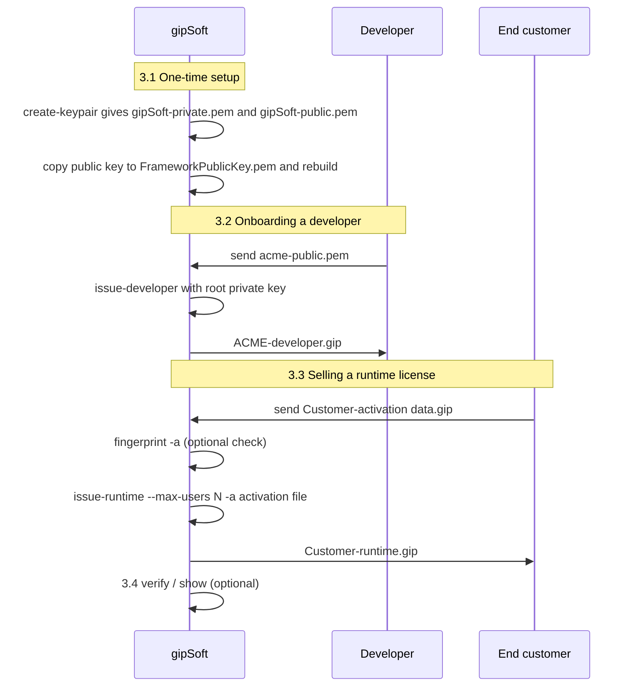
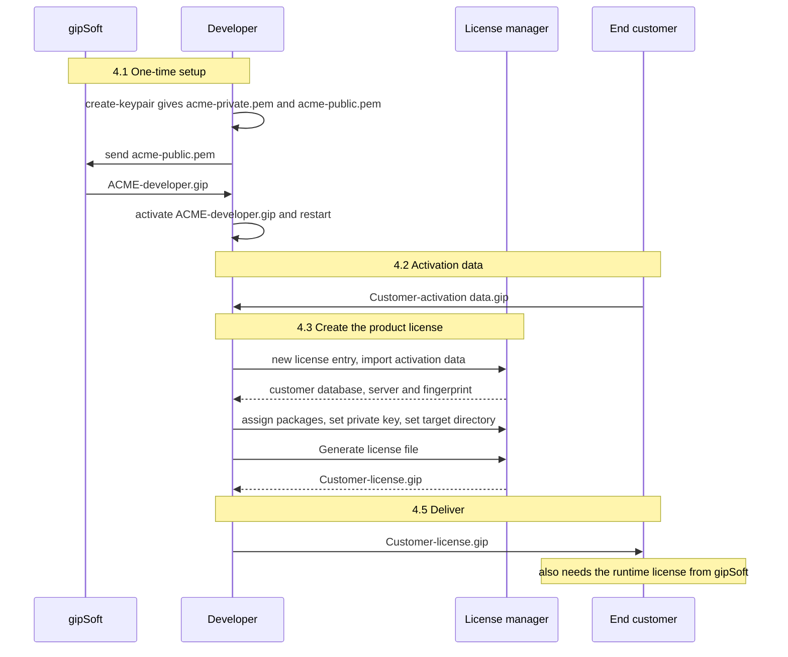
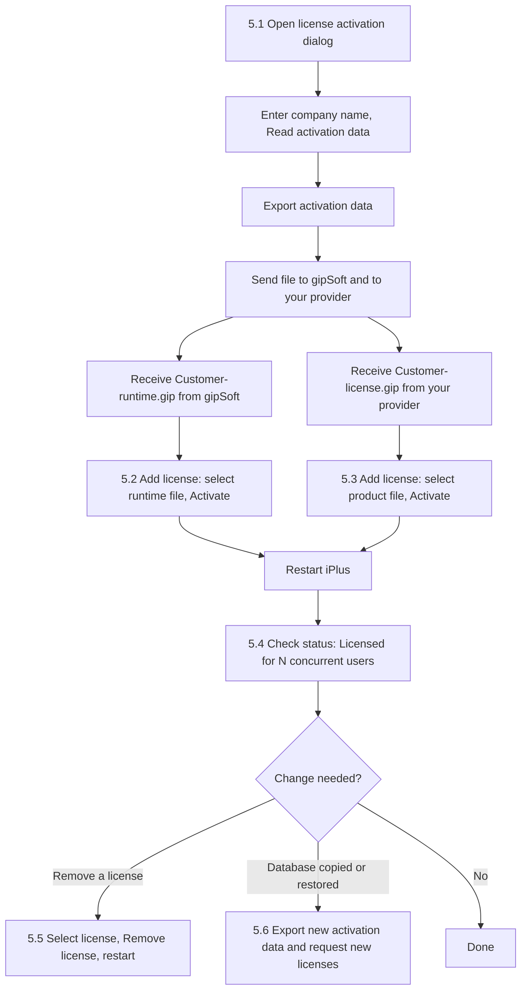

# iPlus Licensing Manual

Step-by-step guide to the iPlus V5 license workflow for the three parties involved:

| Party | Role | Chapter |
|---|---|---|
| **gipSoft** | Framework vendor. Issues developer licenses and runtime licenses. | [3](#3-gipsoft--issuing-developer-and-runtime-licenses) |
| **Developer / integrator** | Builds products on iplus-framework and licenses them to end customers. | [4](#4-developer--licensing-your-product-for-a-customer) |
| **End customer** | Runs the solution on its own iPlus database. | [5](#5-end-customer--installing-licenses) |

Developers and gipSoft: for the technical background (file format, PKI, enforcement code) see
[iplus-licensing-and-packaging.md](./KnowledgeBaseForAI/iplus-licensing-and-packaging.md) and the
[license issuer tool readme](../gip.tool.licenseIssuer/readme.md).

---

## 1. Concepts in five minutes

### 1.1 The four license kinds

| Kind | Issued by | Signed with | Purpose |
|---|---|---|---|
| **DeveloperIssuer** | gipSoft | gipSoft root key | Development installation **and** the right to issue product licenses. Contains the developer's public key and, optionally, the package namespaces the developer may license. |
| **DeveloperEndUser** | gipSoft | gipSoft root key | Development/engineering features only; no right to issue licenses. |
| **FrameworkRuntime** | gipSoft | gipSoft root key | The commercial iPlus runtime of **one customer database**, priced per concurrent user (`MaxUsers`). |
| **Product** | Developer (or gipSoft) | Developer's own private key | The listed packages of a developer's product on **one customer database**. |

### 1.2 What a customer needs

A customer running a commercial solution needs **two** licenses on the same database:

1. a **FrameworkRuntime** license from gipSoft (number of concurrent users), and
2. one **Product** license per solution/developer (list of packages).

A Product license has no effect without the runtime license. Without a runtime license the
installation is the **open edition (GPL-3)**: only GPL-compatible packages run, product licenses are
ignored.

### 1.3 No mixing

| Installation | GPL-3 packages | Commercial packages |
|---|---|---|
| Open edition (no runtime license) | run | blocked |
| Commercial (runtime license present) | blocked, unless the package is also permissive (MIT / Apache-2.0 / BSD-3-Clause) or dual-licensed with a commercial option | run (if covered by a Product license) |
| Developer installation (DeveloperIssuer / DeveloperEndUser license) | run | run |

### 1.4 How trust works (offline, no license server)

```text
gipSoft root key  ──signs──►  DeveloperIssuer license   (contains the developer's PUBLIC key)
Developer key     ──signs──►  Product license            (contains a copy of the DeveloperIssuer license)
gipSoft root key  ──signs──►  FrameworkRuntime license
```

- The **root public key** is built into every iPlus runtime (`gip.core.licensing/FrameworkPublicKey.pem`).
- A Product license carries the developer's `DeveloperIssuer` license, so the customer only has to
  install the Product license and the runtime license — **two files**.
- Everything is verified offline. Nobody needs an internet connection and there is no dongle.

### 1.5 Binding to the customer database

Runtime and Product licenses are bound to a **database fingerprint**. A license issued for one
database is rejected on every other database. The customer exports an *activation data file* from
the license dialog, and the issuer derives the fingerprint from it (see 5.1 and 4.4).

---

## 2. Tools at a glance

| Tool | Used by | For |
|---|---|---|
| `gip.tool.licenseIssuer` (command line) | gipSoft, developers | Create keys, issue developer/runtime/product licenses, verify, show, fingerprint |
| **License manager** (`BSOiPlusLicenseManager`, in the developer's iPlus) | developers | Issue Product licenses with a UI (import activation data, pick packages, generate) |
| **License activation dialog** (`BSOLicenseActivation`, in every iPlus) | everyone | Export activation data, install, list and remove licenses |

`gip.tool.licenseIssuer` lives in the build/install output folder and is **not** on `PATH`. Run it as
`./gip.tool.licenseIssuer …` from that folder, with its full path, or as
`dotnet gip.tool.licenseIssuer.dll …`. All examples below use `./`.

---

## 3. gipSoft — issuing developer and runtime licenses

### Overview



### 3.1 One-time setup: the root key

```bash
./gip.tool.licenseIssuer create-keypair -o ./RootGipKey -n gipSoft
```

This creates `gipSoft-private.pem` and `gipSoft-public.pem`.

- **Keep `gipSoft-private.pem` offline and backed up.** Everyone who holds it can issue runtime and
  developer licenses. If it is lost, every license has to be re-issued under a new key.
- Copy `gipSoft-public.pem` over `gip.core.licensing/FrameworkPublicKey.pem` and **rebuild**
  `gip.core.licensing`. This is the key every released iPlus runtime trusts. Do this *before* the
  first release; changing it later invalidates all issued licenses.
- Optional: the environment variable `IPLUS_LICENSE_PUBLIC_KEY` (path to a PEM) overrides the
  embedded key, e.g. for tests.

### 3.2 Onboarding a developer (DeveloperIssuer license)

1. The developer creates their own key pair (4.1) and sends you the **public** key
   (`…-public.pem`). Never ask for the private key.
2. Issue the developer license:

```bash
./gip.tool.licenseIssuer issue-developer \
  --private-key ./RootGipKey/gipSoft-private.pem \
  -o ./ACME/ACME-developer.gip \
  --customer "ACME GmbH" \
  --project-no P-2026-001 \
  --issuer-name "gipSoft d.o.o." \
  --developer-public-key ./ACME/acme-public.pem \
  --package-namespace acme \
  --expires 2027-12-31
```

| Option | Meaning |
|---|---|
| `--developer-public-key` | The developer's public key; it ends up inside the license. Required for an issuer license. |
| `--package-namespace` (repeatable) | The packages the developer may license: the first segment of the package name (`acme` for `acme.Orders`) or a full package name. **Omit it to allow all packages** (use this for gipSoft's own MES). With a namespace that matches nothing the developer's package list stays empty. |
| `--end-user` | Issue a *DeveloperEndUser* license instead (no right to issue licenses). |
| `--expires` | Optional expiry date. |

3. Send `ACME-developer.gip` to the developer.

### 3.3 Selling a runtime license (FrameworkRuntime)

1. The customer (or the integrator on their behalf) sends you the **activation data file**
   (`<Customer>-activation data.gip`, see 5.1).
2. Optional: check what the file contains:

```bash
./gip.tool.licenseIssuer fingerprint -a "Customer-activation data.gip"
```

3. Issue the runtime license. `--max-users` is the number of concurrent sessions that were sold:

```bash
./gip.tool.licenseIssuer issue-runtime \
  --private-key ./RootGipKey/gipSoft-private.pem \
  -o ./Customer/Customer-runtime.gip \
  --customer "Customer" --project-no 10000052 \
  --issuer-name "gipSoft d.o.o." \
  --max-users 25 \
  -a "./Customer/Customer-activation data.gip"
```

`-a/--activation-file` takes the fingerprint from the activation file. Alternatively pass
`--database-fingerprint <value>`; use one of the two, not both. `--expires` limits the license in time.

4. Send `Customer-runtime.gip` to the customer.

**Increasing the number of users:** issue a new runtime license with the higher `--max-users` for the
same database and let the customer install it (5.3). Only one runtime license is effective at a
time; the customer can remove the old one (5.5).

### 3.4 Checking a license

```bash
./gip.tool.licenseIssuer verify -l ./Customer/Customer-runtime.gip \
  --database-fingerprint <fingerprint>      # prints VALID / the reason it is invalid
./gip.tool.licenseIssuer show -l ./Customer/Customer-runtime.gip   # payload only, no verification
```

`verify` exit codes: `0` valid, `2` invalid, `1` usage/IO error.

---

## 4. Developer — licensing your product for a customer

You need: an iPlus installation of your own (your *development database*) with your
`DeveloperIssuer` license installed, and your private key.

### Overview



Alternative to 4.3: run `issue-product` on the command line (4.4); the result is the same file.

### 4.1 One-time setup

1. Create your key pair:

```bash
./gip.tool.licenseIssuer create-keypair -o ./Key -n acme
```

2. Send `acme-public.pem` to gipSoft. **Keep `acme-private.pem` secret and backed up.** It signs all
   your Product licenses; if it is lost you cannot issue licenses any more, if it leaks others can
   issue licenses in your name.
3. gipSoft returns `ACME-developer.gip`. Install it in your development iPlus:
   open the **license activation dialog** → *Add license* → browse to the file → *Activate*,
   then restart.

After the restart your installation is a developer installation: all packages run and the license
manager can issue licenses.

### 4.2 Receive the activation data from the customer

Ask the customer to export their activation data (chapter 5.1) and send you
`<Customer>-activation data.gip`. The file contains the company name, database and server name and an
identification code. It contains no secrets.

### 4.3 Create the Product license in the license manager

1. Open the **license manager** (`BSOiPlusLicenseManager`) and create a new license entry for the
   customer (customer name, project number).
2. Click **Import activation data** and select the customer's file. The customer's database name,
   server and **fingerprint** are filled in (read-only). *Never* use your own database's fingerprint.
3. Choose the packages: the *Available packages* list shows the packages your license allows.
   Move the ones the customer bought to *Assigned packages* with `>`, `>>`, `<`, `<<`.
4. Set **Developer private key (\*.pem)** to your `acme-private.pem` (the private key, not a `.gip` file).
5. Set the **License file directory path** where the file should be written.
6. Click **Generate license file**. The result is a signed `<Customer>-license.gip`
   that is bound to the customer's database and contains your `DeveloperIssuer` license.

The button is only enabled when a valid private key and a customer fingerprint are present.

### 4.4 Alternative: command line

```bash
./gip.tool.licenseIssuer issue-product \
  --private-key ./Key/acme-private.pem \
  -o ./Customer/Customer-license.gip \
  --customer "Customer" --project-no 10000052 \
  --issuer-name "ACME GmbH" \
  -p acme.Orders -p acme.Planning \
  --issuer-license ./Key/ACME-developer.gip \
  -a "./Customer/Customer-activation data.gip"
```

`--issuer-license` embeds your `DeveloperIssuer` license so that the customer needs only this one
file. `--expires` and `--max-users` are optional.

### 4.5 Deliver

Send the customer:

1. `Customer-license.gip` (your Product license), and
2. make sure the customer also has a **runtime license from gipSoft** (3.3). Without it your
   Product license has no effect.

### 4.6 Several developers on the same customer

A customer can have any number of Product licenses (one per developer/product). Each is verified
against its own developer license, and they do not interfere. Only one runtime license is effective.

### 4.7 GPL and commercial packages

Your packages declare their license in the assembly metadata (`iPlusLicense`, SPDX expression, e.g.
`GPL-3.0-only`, `LicenseRef-Commercial`, `GPL-3.0-only OR LicenseRef-Commercial`). Customers with a
commercial runtime cannot run GPL-3-only packages and open-edition customers cannot run
commercial-only packages (1.3). Choose the expression to match how you distribute the package; see
the knowledge base, chapter 6, for details.

---

## 5. End customer — installing licenses

### Overview



### 5.1 Step 1: export the activation data

1. Open the **license activation dialog** (menu *Product activation*).
2. Enter the company name and click **Read activation data**.
3. Click **Export activation data**, choose a folder and click **Export**. The file is named
   `<Company>-activation data.gip`.
4. Send this file to your software provider (the developer) **and** to gipSoft for the runtime license.

The data identifies your database. Export it from the database on which the software will run.

### 5.2 Step 2: install the runtime license (from gipSoft)

1. Open the license activation dialog. If a license is already installed click **Add license**; on a fresh installation the dialog already shows the activation view.
2. Click the browse button (`…`) and select `<Customer>-runtime.gip`.
3. Click **Activate**. A confirmation appears.
4. **Restart iPlus.**

### 5.3 Step 3: install the product license (from your provider)

Repeat 5.2 with `<Customer>-license.gip`. Install the runtime and product license in either order;
both are required, then restart.

### 5.4 Checking the result

Open the license activation dialog:

- the status shows *Licensed to <Customer>* with a tick, and the line
  *"<Customer> — Licensed for N concurrent users"*;
- *Package details* lists the license publishers; select one to see its licensed packages and
  project number.

| Dialog text | Meaning |
|---|---|
| *Open edition (GPL-3)…* | No runtime license is installed. |
| *Product license installed, but no framework runtime license…* | The product is installed, but its packages stay locked until the runtime license is activated. |
| *Licensed for N concurrent users* | Runtime license active. N sessions are licensed. |

**Number of users:** the limit comes from the runtime license. If more than N sessions are open at
once, iPlus shows an information dialog (about every 4 hours); nobody is locked out.

### 5.5 Removing a license

In the license activation dialog select the license in the *License publisher* list and click
**Remove license**; confirm and restart. Removing the runtime license puts the installation back into
the open edition. You can install the license again at any time (5.2).

### 5.6 After a database copy or restore

Licenses are bound to the database. If the database is restored into a **different database**
(new database name/server or a different physical database), the fingerprint changes and the licenses
no longer match. Export new activation data and request new licenses.

---

## 6. When something is wrong

### 6.1 Grace period

If a package is blocked by a license problem, iPlus does not stop immediately:

| Time since the problem was detected | Behaviour |
|---|---|
| 0 – 30 minutes | Silent. |
| after 30 minutes | A warning is shown (once). |
| after 1.5 days | The unlicensed components are blocked. |

Installing a valid license restarts the grace period. The start time is stored in
`Licenses/.licensegrace` next to the application, so restarting does not reset it.

### 6.2 Error messages when activating

| Message / symptom | Cause | Solution |
|---|---|---|
| `InvalidSignature` | The license was signed with an unknown key, or the file was changed. | Request the license again; check that gipSoft's public key was built into your version. |
| `DatabaseMismatch` / fingerprint error | The license was issued for another database. | Export activation data from *this* database and request a new license. |
| *Expired* | The license has an expiry date that has passed. | Request a renewal. |
| Product licensed, but packages do not run | No runtime license, or the package's license (GPL/commercial) does not fit the edition (1.3). | Install the runtime license, check the package's license expression. |
| *Add license* / *Close* / browse button disabled | An outdated client build. | Update iPlus. |
| Generate license file is disabled (developer) | No private key or no customer fingerprint. | Import the activation data and select the `*-private.pem` file. |
| Available packages list is empty (developer) | The `DeveloperIssuer` license has a `--package-namespace` that matches none of your packages. | Ask gipSoft for a license with the correct namespace. |
| *"…is not a private key file"* | The *Developer private key* field points to a license, not the `.pem`. | Select `acme-private.pem`. |

### 6.3 Questions for gipSoft support

Run `./gip.tool.licenseIssuer show -l <file>` to see the contents of a license (customer, kind,
packages, users, expiry, database fingerprint) and `verify` to see why it is rejected. Send the output
and the activation data file.

---

## 7. Checklists

### gipSoft

- [ ] Root key pair created, private key stored offline and backed up
- [ ] `gipSoft-public.pem` copied to `gip.core.licensing/FrameworkPublicKey.pem`, release built
- [ ] Developer public key received → `issue-developer` → license sent
- [ ] Customer activation data received → `issue-runtime --max-users N -a …` → license sent

### Developer

- [ ] Own key pair created, private key backed up, public key sent to gipSoft
- [ ] `DeveloperIssuer` license installed (*Add license*), iPlus restarted
- [ ] Activation data received from the customer
- [ ] Packages assigned, **Generate license file** (or `issue-product -a …`)
- [ ] Product license sent to the customer; customer has a runtime license

### End customer

- [ ] Activation data exported and sent
- [ ] Runtime license installed (*Add license* → *Activate*)
- [ ] Product license installed
- [ ] iPlus restarted; status shows the number of users and the packages
